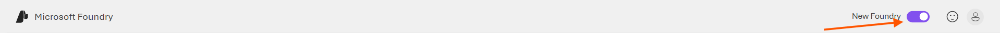
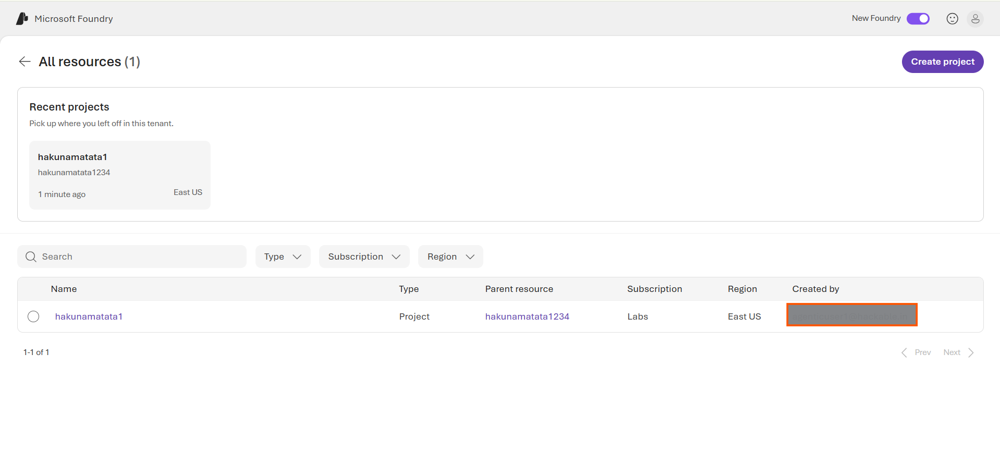
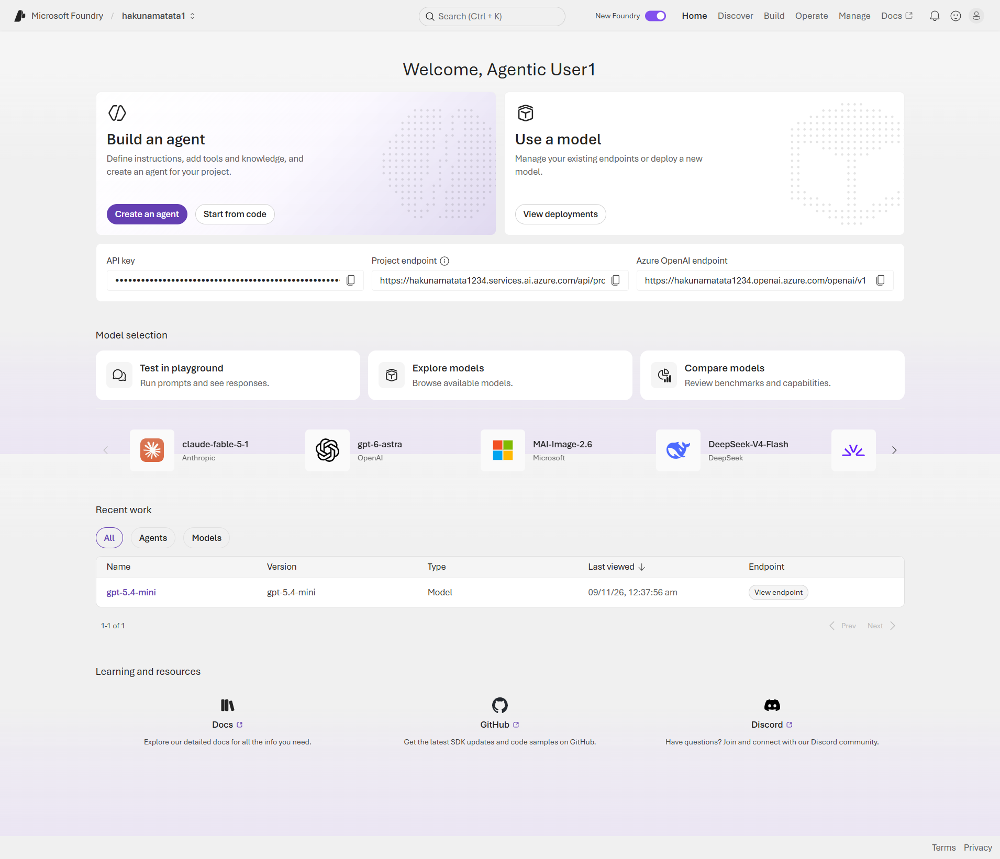
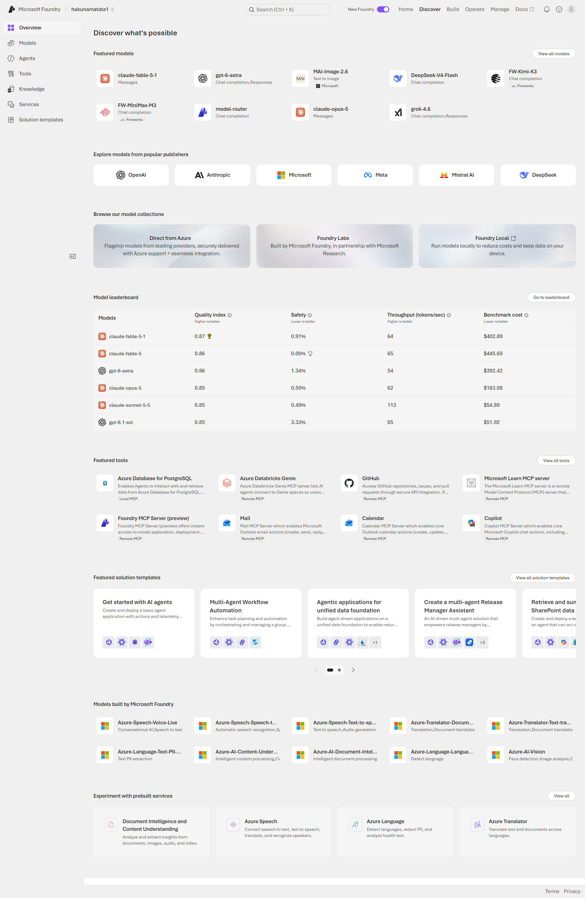
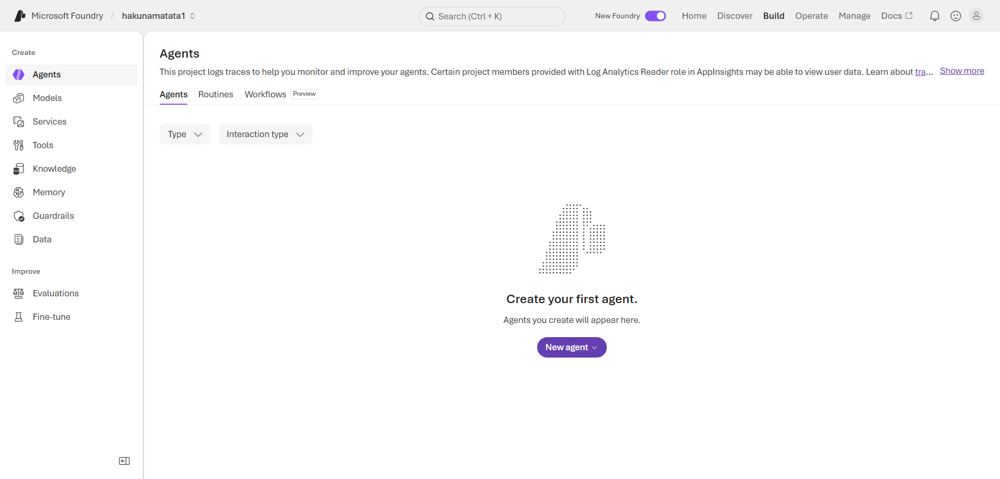
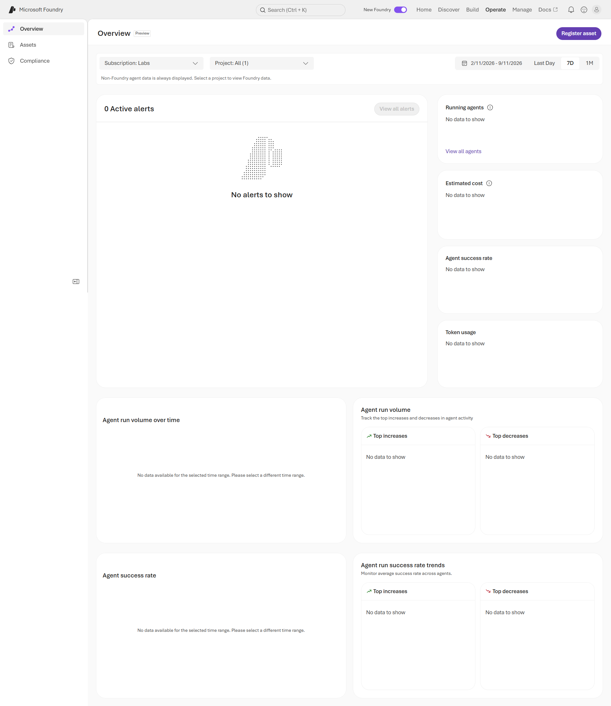
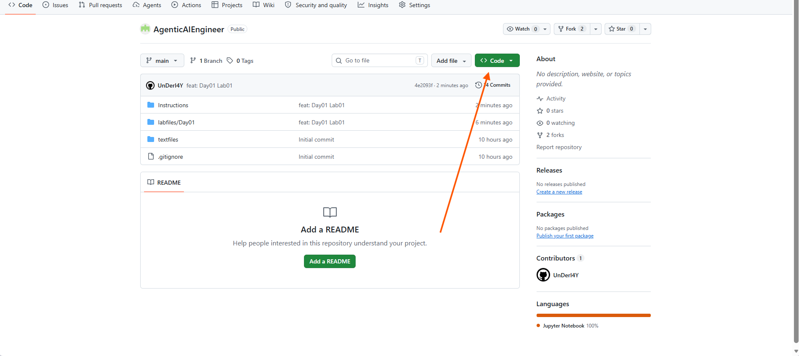

---
lab:
  title: Explore Azure AI Foundry and call a deployed model
  description: Learn how to navigate Azure AI Foundry, test a deployed model in the Chat Playground, and call it from a Jupyter notebook using the SDK and REST.
  level: 200
  duration: 30
  islab: true
  status: 'released'
---

# Explore Azure AI Foundry and call a deployed model

**Note: This document has three parts. Part 1 is an optional fundamentals recap that you can open if you want a refresher. Part 2 is a tour of the Azure AI Foundry portal. Part 3 sends you to the lab notebook, where you run the code.**

In this exercise, you will use a project and a model deployment that are already set up for you. You will find them in the Azure AI Foundry portal, test the deployed model in the Chat Playground, and then call the same model from a Jupyter notebook using the OpenAI SDK and REST.

This exercise takes approximately **30** minutes.

> **Note**: Some of the technologies used in this exercise are in preview or in active development. You may see unexpected behavior, warnings, or errors.

## What you will use in this lab

You do not create a project, and you do not deploy a model. Both are ready for you.

- **Project:** The workspace in Azure AI Foundry that holds your model deployment, your endpoint, and your key. Your project is already created.
- **Deployed model:** A model that is running and ready to receive requests. In this lab, the deployed model is **gpt-5.4-mini**.

Because of this, the lab only uses the terms and settings that help you work with an existing project and an existing deployment. Parts of the portal that are used to create or deploy things are described briefly so that you recognize them, but you do not need to use them.

If you cannot see your project or the **gpt-5.4-mini** deployment, tell the instructor before you continue.

## Prerequisites

- [Visual Studio Code](https://code.visualstudio.com/) installed on your local machine
- Python 3.12.1 available as a kernel
- The **Python (Microsoft)** and **Jupyter (Microsoft)** extensions installed and enabled in VS Code
- Microsoft Edge (or another web browser)
- Basic familiarity with running notebook cells (you do not need to know Python already; the code is provided)

> A Foundry project with the **gpt-5.4-mini** model already deployed has been set up for you. If more than one AI Foundry resource is available, ask the instructor which resource to use. Use the resource and model from the demonstration unless the instructor tells you otherwise.
>
> **Important:** Copy the endpoint and the key into a local text file (for example, Notepad) and keep them somewhere safe. You will use them in the notebook.
>
> **Tip:** Keep the Azure AI Foundry project page open in Microsoft Edge for easy access during the lab.

---

# Part 1: Fundamentals recap (optional)

Open any section below if you want to refresh a concept. You can skip this part and come back to it later. Every concept here appears in the lab.

<strong>What generative AI is</strong>

Generative AI refers to models that learn patterns from large datasets and then produce new content. The content can be text, code, images, audio, video, or structured JSON.

A discriminative model decides which class an input belongs to. A generative model creates new content that fits the patterns it learned.

- **Discriminative example:** "Is this email spam?" The model answers with a class, such as spam or not spam.
- **Generative example:** "Draft a reply to this email in a friendly tone." The model writes new text.

Cloud platforms such as Azure AI Foundry let you use these models through a web portal (the playground) and through code (an API).

<strong>What a large language model is and how it produces text</strong>

A large language model (LLM) is a neural network that is trained on very large amounts of text and code to predict the next token. A model that predicts the next token well can write sentences, answer questions, follow instructions, write code, and return information in a fixed format.

These ideas explain how an LLM produces a reply:

- **Token:** A small piece of text, often a part of a word. The model reads and writes tokens. Length limits and cost are counted in tokens, not in characters or words. For example, the word "Internationalization" can be split into the tokens "International" and "ization".
- **Embedding:** A list of numbers that represents the meaning of a token. The model works with these numbers.
- **Next-token prediction:** The model reads your prompt, predicts the most suitable next token, adds it to the text, and repeats this step until the reply is complete.
- **Context window:** The largest number of tokens that the prompt and the reply can use together. If a request needs more tokens than the context window allows, the request fails or the text is cut off.
- **Training:** The model first learns general language patterns from a very large set of text and code. Later training steps teach it to follow instructions and to respond in a helpful and safe way. This training is already finished for the model you will use.

<strong>The settings you will use in the lab</strong>

You control the model's reply with the settings below. The notebook uses the first five. The last two are in the playground and in the notebook as optional controls.

- **System message:** An instruction that sets the role, the tone, and the format rules for the model. For example, "You are a concise Azure assistant." or "Return ONLY valid JSON."
- **User message:** Your question or task. The model answers it.
- **Maximum output tokens (`max_output_tokens`):** The largest number of tokens the reply can contain. A smaller limit gives shorter replies and lower cost. If the limit is too small, the reply is cut off.
- **Streaming (`stream=True`):** The reply arrives in small parts while the model writes it, instead of arriving as one block after it finishes. The total number of tokens does not change.
- **JSON output:** You ask for a reply in JSON, with fixed keys, so that code can read the reply reliably. Your code should still check that the reply is valid JSON before it uses it.
- **Reasoning effort (`reasoning`):** For models that support it, this setting controls how much the model reasons before it writes the answer. The reasoning uses tokens, and those tokens count toward `max_output_tokens`. When the limit is very small, reasoning can use all the tokens and leave no room for the answer. The notebook explains what to do in that case.
- **Temperature and top-p:** These settings control how varied the reply is. A lower temperature gives more consistent replies, and a temperature near 0 gives the most predictable ones. A higher temperature gives more varied replies. Top-p limits the choice to the smallest group of likely tokens whose probabilities add up to the value p. Some models do not allow you to change these two settings.

<strong>Terms you will see in the lab</strong>

- **Project:** The workspace in Azure AI Foundry that contains your deployment, endpoint, and key.
- **Deployment:** A model that is running in your project and can receive requests. Your deployment is **gpt-5.4-mini**.
- **Deployment name:** The name that your code sends in the `model` field. In this lab, it is `gpt-5.4-mini`.
- **Endpoint:** The web address that your code sends requests to.
- **API key:** A secret value that proves your code is allowed to use the deployment. Treat it like a password. Do not share it, and do not paste it in public places.
- **Responses API:** The API that the notebook calls. You send messages to it and it returns the model's reply.
- **SDK:** A code library that makes the API easier to call. The notebook uses the OpenAI Python SDK.
- **REST:** Calling the API directly with an HTTP request. The notebook shows one REST call with the `requests` library.
- **Playground:** A page in the portal where you try prompts without writing code.
- **Hallucination:** A reply that sounds confident but is wrong or has no basis. Check important answers against a reliable source.
- **Grounding:** Giving the model trusted information to base its answer on, so that the answer relies on that information.

<strong>Safe use of a model</strong>

- Do not send secrets, passwords, or personal data in a prompt.
- Keep your API key private. Remove the key from the notebook before you save or share it.
- Check important answers, because a model can produce wrong content.
- Keep the system message clear, so that the model knows the role and the format that you expect.

<strong>Self-check with answers</strong>

1. **What is the difference between a generative model and a discriminative model?**
   A generative model creates new content. A discriminative model decides which class an input belongs to.

2. **Which setting do you lower to make replies more consistent?**
   The temperature.

3. **What is the context window, and why does it matter for cost and latency?**
   The context window is the largest number of tokens that the prompt and the reply can use together. A request with more tokens costs more and takes longer to process.

4. **Name one risk of using a model and one way to reduce it.**
   One risk is hallucination. You reduce it by checking important answers against a reliable source.

5. **Where do you find the endpoint and the key of your deployment?**
   On the **Details** tab of the deployed model page in the Azure AI Foundry portal.

---

# Part 2: Explore Azure AI Foundry

In this part, you will explore the Azure AI Foundry portal. No coding is required. You will use the project and the **gpt-5.4-mini** deployment that you created earlier.

## Open Your Project

1. Navigate to the Azure AI Foundry portal: <https://ai.azure.com/>.
2. Sign in with your Azure account.
3. Open the project named **hakunamatata1** that was created for you.
4. Ensure that you are using the **New Foundry UI**. If the **New Foundry** toggle in the upper-right corner is disabled, enable it before continuing.

> **Note:** After signing in to Microsoft Foundry ([ai.azure.com](https://ai.azure.com/)), you may be redirected to the **All Resources** page, as shown below. If you are not redirected to this page, skip to the **Azure AI Foundry Home Page** section. The **All Resources** page displays the AI Foundry resources and projects available in your Azure subscription.

## Overview of the All Resources Page

### Top Section

| Location | Description | Use |
|----------|-------------|-----|
| Recent Projects | Displays projects that were recently accessed. | Quickly reopen an existing project and continue your work. |
| Create Project | Creates a new AI Foundry project. | Create a new project for building AI applications, agents, and solutions. |

### Resource List Section

| Location | Description | Use |
|----------|-------------|-----|
| Search | Search box for resources and projects. | Find a specific project or resource. |
| Type Filter | Filters resources by resource type. | Display only selected resource types. |
| Subscription Filter | Filters resources by Azure subscription. | Display resources from a specific subscription. |
| Region Filter | Filters resources by Azure region. | Display resources deployed in a selected region. |
| Name | Displays the project name. | Select a project to open and manage it. |
| Type | Displays the resource type. | Identify the type of resource. |
| Parent Resource | Displays the AI Foundry resource associated with the project. | Identify the resource that hosts the project. |
| Subscription | Displays the Azure subscription associated with the resource. | Verify resource ownership and billing context. |
| Region | Displays the Azure region where the resource is | Displays the account that created the resource. | Identify the creator of the resource. |

4. Select your project from the resource list to open it.
5. Wait for the project dashboard to load before proceeding to the next section.

## Azure AI Foundry Home Page

After you open the **hakunamatata1** project, the **Home** page appears. This page provides quick access to common Azure AI Foundry tasks, project details, model deployments, and learning resources.

| Location | Description | Use |
|----------|-------------|-----|
| Project Selector | Displays the current project name (`hakunamatata1`). | Switch between available projects. |
| Search Bar | Global search bar located at the top of the page. | Search for models, deployments, resources, and project assets. |
| New Foundry Toggle | Switches between the classic and new Foundry experience. | Enable the latest Azure AI Foundry user interface. |
| Home | Home page of the current project. | View project information and quick-start options. |
| Discover | Catalog of available AI capabilities and models. | Explore models, services, and AI features. |
| Build | Development area for AI applications and agents. | Create agents, prompts, flows, and other AI components. |
| Operate | Monitoring and operational tools. | Track usage, performance, and operational activities. |
| Manage | Project management and configuration area. | Configure project settings, connections, and resources. |
| Docs | Opens Azure AI Foundry documentation. | Access product documentation and learning materials. |
| Build an Agent | Quick-start card for creating AI agents. | Create and configure an agent for your project. |
| Use a Model | Quick-start card for working with deployed models. | View and manage model deployments. |
| API Key | Authentication key for the project. | Use the key to authenticate applications and API requests. |
| Project Endpoint | Endpoint URL for the current project. | Connect applications and SDKs to the project. |
| Azure OpenAI Endpoint | Azure OpenAI service endpoint URL. | Send requests to deployed Azure OpenAI models. |
| Test in Playground | Opens the playground experience. | Run prompts and test model responses. |
| Explore Models | Opens the model catalog. | Browse and compare available foundation models. |
| Compare Models | Opens model comparison tools. | Compare benchmarks, pricing, and capabilities. |
| Model Selection | Displays featured and available models. | Discover models supported by Azure AI Foundry. |
| Recent Work | Displays recently used project assets. | Quickly access models, agents, and other resources. |
| Learning and Resources | Links to documentation, GitHub repositories, and community resources. | Learn more about Azure AI Foundry and 

## Discover Page

Select **Discover** from the top navigation menu. The **Discover** page helps you explore available models, tools, services, and solution templates in Azure AI Foundry.

| Location | Description | Use |
|----------|-------------|-----|
| Overview | Landing page of the Discover section. | View featured models, tools, services, and solution templates. |
| Models | Catalog of available AI models. | Browse and evaluate models from Azure OpenAI, Microsoft, Anthropic, Meta, DeepSeek, and other providers. |
| Agents | Collection of agent-related resources and templates. | Explore prebuilt agent capabilities and agent development options. |
| Tools | Available tools and integrations for AI applications. | Add capabilities such as GitHub, Databricks, Calendar, and MCP servers to your solutions. |
| Knowledge | Knowledge sources and knowledge management features. | Connect and manage data sources used by agents and AI applications. |
| Services | AI services available in Azure AI Foundry. | Access services such as Speech, Language, Translator, and Document Intelligence. |
| Solution Templates | Prebuilt AI solution templates. | Accelerate development by starting from ready-made solutions. |
| Featured Models | Highlights selected foundation models. | Explore popular and recommended models. |
| Popular Publishers | Displays model providers such as OpenAI, Anthropic, Microsoft, Meta, Mistral AI, and DeepSeek. | Browse models from a specific provider. |
| Model Collections | Curated collections of related models. | Explore groups of models organized by scenario or provider. |
| Model Leaderboard | Compares models using quality, safety, throughput, and cost metrics. | Evaluate and compare models before deployment. |
| Featured Tools | Recommended tools and integrations. | Discover tools that extend AI application capabilities. |
| Featured Solution Templates | Prebuilt end-to-end solution examples. | Start quickly with common AI application scenarios. |
| Models Built by Microsoft Foundry | Collection of Microsoft-developed AI models and services. | Explore Microsoft AI offerings available within Foundry. |
| Experiment with Prebuilt Services | Collection of ready-to-use Azure AI services. | Test Speech, Language, Translator, and Document Intelligence services without building a custom solution. |
| View All Models | Opens the complete model catalog. | Browse all available foundation models. |
| View All Tools | Opens the complete tool catalog. | Explore all available integrations and utilities. |
| View All Solution Templates | Opens the full template library. | Browse all available starter solutions. |

> **Tip:** The **Discover** page is typically the starting point for exploring new vices, and solution templates before building AI applications in Azure AI Foundry.

## Build Page

Select **Build** from the top navigation menu. This is the most important area in Azure AI Foundry and the section where you will spend most of your time during the upcoming labs. The **Build** page is used to create, configure, test, and manage AI agents, models, tools, knowledge sources, and other project resources.

| Location | Description | Use |
|----------|-------------|-----|
| Agents | Create and manage AI agents. | Build, configure, test, and monitor agents for your applications. |
| Models | Manage model deployments within the project. | Deploy, view, and use foundation models in your solutions. |
| Services | Access Azure AI services connected to the project. | Configure and use services such as Azure OpenAI and Azure AI Services. |
| Tools | Add tools that agents can use. | Enable capabilities such as API calls, GitHub access, databases, and MCP servers. |
| Knowledge | Manage knowledge sources. | Connect documents and data sources that agents can reference. |
| Memory | Configure memory for agents. | Store and retrieve conversational context across interactions. |
| Guardrails | Define safety and compliance controls. | Apply content filtering, safety policies, and governance settings. |
| Data | Manage project data assets. | Upload and organize data used by agents and AI applications. |
| Evaluations | Evaluate model and agent performance. | Measure quality, accuracy, safety, and response effectiveness. |
| Fine-tune | Fine-tune supported models. | Customize models using your own training data. |
| Agents Tab | Lists all agents created in the project. | View and manage available agents. |
| Routines Tab | Create reusable task sequences. | Automate repetitive agent actions and workflows. |
| Workflows Tab | Build multi-step workflows. | Orchestrate complex AI processes involving multiple actions. |
| New Agent | Creates a new AI agent. | Start building an agent for a specific business or technical scenario. |
| Type Filter | Filters items by type. | Narrow displayed resources based on their category. |
| Interaction Type Filter | Filters agents by interaction style. | View only agents with a specific interaction model. |

> **Important:** The **Build** section is the primary workspace in Azure AI Foundry. Most hands-on lab activities, including creating agents, configuring tools, connecting knowledge sources, and testing AI solutions, will be performed from this area.

## Operate Page

Select **Operate** from the top navigation menu. The **Operate** page helps you monitor, manage, and track the operational health of your AI solutions. This section becomes more useful after you begin creating and using agents because it provides insights into agent activity, performance, usage, costs, and operational metrics.

| Location | Description | Use |
|----------|-------------|-----|
| Overview | Displays operational insights across the project. | Monitor agent activity, usage, and performance metrics. |
| Assets | Lists deployed and registered project assets. | View and manage operational resources. |
| Compliance | Displays compliance-related monitoring and governance information. | Review compliance and operational policies. |
| Subscription Filter | Selects the Azure subscription to monitor. | View metrics for a specific subscription. |
| Project Filter | Selects the project to monitor. | Display operational data for a specific project. |
| Time Range Filter | Selects the reporting period (Day, 7 Days, 1 Month, etc.). | Analyze trends over a chosen time period. |
| Register Asset | Registers an asset for monitoring and management. | Track and manage deployed resources. |
| Active Alerts | Displays operational alerts. | Identify issues that require attention. |
| Running Agents | Displays agents currently running. | Monitor active agent workloads. |
| Estimated Cost | Displays estimated project costs. | Track resource consumption and spending. |
| Agent Success Rate | Displays agent execution success metrics. | Evaluate reliability and performance. |
| Token Usage | Displays token consumption statistics. | Monitor model usage and associated costs. |
| Agent Run Volume Over Time | Shows trends in agent execution volume. | Analyze agent activity patterns. |
| Agent Run Volume | Summarizes increases and decreases in agent activity. | Identify workload trends. |
| Agent Run Success Rate Trends | Shows success rate patterns over time. | Detect operational issues and performance changes. |

> **Important:** During the early labs, many sections on this page may show **No data to show** because no agents have been created or executed yet. As you build and test agents in later labs, the dashboards on this page will begin displaying operational metrics.

> **Tip:** You will spend most of your time in the **Build** section during the upcoming labs. The **Operate** section is primarily used for monitoring, troubleshooting, cost tracking, and reviewing the performance of agents after they have been deployed and used.

## Manage and Additional Navigation Options

The remaining options in the Azure AI Foundry portal help you manage project resources, access documentation, review notifications, and manage your account settings.

| Location | Description | Use |
|----------|-------------|-----|
| Manage | Project administration and configuration area. | Manage project settings, connected resources, users, permissions, and deployment configurations. |
| Docs | Opens Microsoft Foundry documentation on Microsoft Learn. | Access product documentation, tutorials, learning paths, and reference material. |
| Feedback (😊) | Opens the feedback option. | Submit product feedback, suggestions, or report your experience with Azure AI Foundry. |
| Notifications (🔔) | Notification center. | View alerts, updates, deployment notifications, and service messages. |
| Profile (👤) | User profile menu. | Access account information, profile settings, and sign-out options. |

> **Note:** Selecting **Docs** opens the Microsoft Learn documentation for Azure AI Foundry:
>
> [Microsoft Foundry documentation | Microsoft Learn](https://learn.microsoft.com/en-us/azure/foundry/)

## Footer Links

Return to the **Home** page and scroll to the bottom. The footer contains additional links related to legal and privacy information.

| Location | Description | Use |
|----------|-------------|-----|
| Terms | Microsoft Azure legal information page. | Review Azure terms, licensing information, and legal notices. |
| Privacy | Microsoft Privacy Statement. | Review Microsoft's privacy policies and data handling practices. |

> **Note:** The footer links redirect to the following pages:
>
> - **Terms:** [Microsoft Azure Legal Information](https://azure.microsoft.com/en-us/support/legal/)
> - **Privacy:** [Microsoft Privacy Statement](https://www.microsoft.com/en-us/privacy/privacystatement)

> **Important:** You will spend most of your time in the **Build** section during the upcoming labs. The **Discover**, **Operate**, and **Manage** sections are primarily used to explore capabilities, monitor resources, and administer your project as your solutions become more advanced.

---

# Part 3: Run the lab

You now know the concepts that the lab uses, and you know where to find your project, your deployed model, the Playground, the endpoint, and the key. Next, run the code in the lab notebook.

### Prepare the application configuration

1. Open a web browser and go to the [GitHub](https://github.com/Kiran-255666/AgenticAIEngineer).
1. On the repo page, select the green **`<> Code`** button, then select **Download ZIP**.

    
1. Once the download finishes, locate the ZIP file and extract it to a folder on your computer. **Ensure that there are no other ZIP files or extracted folders with the same name in the Downloads folder.**

## Summary

You used a project and a model deployment that were already set up for you. You learned the concepts that the lab uses, you toured the Azure AI Foundry portal, you tested **gpt-5.4-mini** in the Chat Playground, and you found the endpoint and key that your code needs. You now have the knowledge to run the lab.

---

**Next step:** Open **labfiles/Day01/lab01-azure-ai-foundry.ipynb** locally in vscode and run the notebook as it instructs.