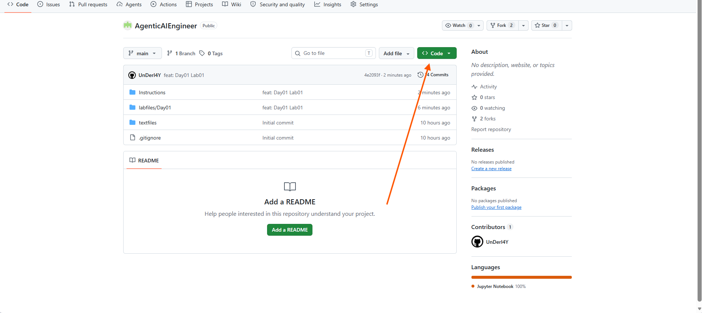
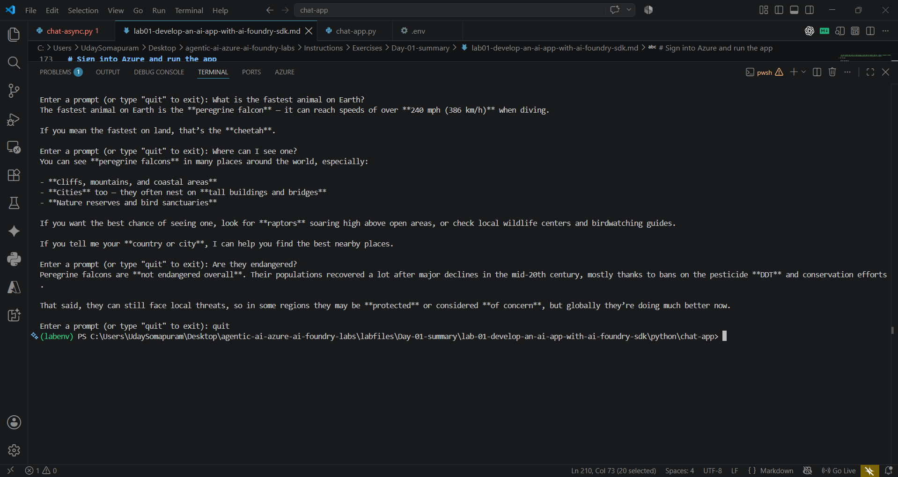

---
lab:
  title: Create a generative AI chat app
  description: Learn how to build a simple Python app that connects to a deployed model in Microsoft Foundry and chats with it.
  level: 200
  duration: 30
  islab: true
  status: 'released'
---

# Create a generative AI chat app

> [!NOTE]
> The required code has already been added to the referenced files. However, we strongly recommend reviewing the code and understanding its functionality before executing it.

In this exercise, you'll use the Microsoft Foundry Python SDK to build a small app that sends messages to a language model and shows its replies.

This exercise takes approximately **30** minutes.

> **Note**: Some of the technologies used in this exercise are in preview or in active development. You may see unexpected behavior, warnings, or errors.

Before starting this exercise, ensure you have:

## Prerequisites

- The credentials provided for this lab
- Python 3.12 or later installed
- Visual Studio Code installed
- A web browser
- Basic familiarity with running terminal commands

## Find Your Project Endpoint and Deployment Name

1. Return to the [Microsoft Foundry portal](https://ai.azure.com) and open the project provided for this lab.
2. On the project home page, copy the **Azure OpenAI endpoint** value.
3. Open the **gpt-5.4-mini** deployment from the **Recent work** section.
4. Note the deployment name (**gpt-5.4-mini**).
5. Take a moment to review these values and where they are located in Azure AI Foundry.

> [!NOTE]
> The `.env` file used in this lab is already pre-populated with the required values for convenience. The steps above are included to help you understand where values such as the project endpoint and deployment name are obtained in Azure AI Foundry. In real-world projects, teams often provide a `.env.example` file, and developers are responsible for creating and populating their own `.env` file with the required configuration values. As a best practice, never commit or push your `.env` file to GitHub, as it may contain sensitive information such as API keys, endpoints, and other credentials.

# Create a client application to chat with the model

You'll write a small Python app that connects to your Foundry project and holds a conversation with the deployed model. A **client application** here just means code that runs on your machine and talks to the model over the internet.

### Clean Up Previous Downloads

1. Open your **Downloads** folder.
2. Delete previously downloaded ZIP file and extracted folders.

> [!NOTE]
> The repository has been updated. Keeping older copies may result in folders such as `AgenticAIEngineer-main (1)`, which can cause the commands used in this lab to fail or reference the wrong location.

### Prepare the application configuration

1. Open a web browser and go to the [GitHub](https://github.com/Kiran-255666/AgenticAIEngineer).

2. On the repo page, select the green **`<> Code`** button, then select **Download ZIP**.

    

3. Once the download finishes, locate the ZIP file and extract it to a folder on your computer. 

4. **Copy the `chat-app` folder to the Desktop:**

   **Use PowerShell to run the following commands to copy the folder to the Desktop and open it in VS Code. The path below is an example; verify your actual path before running the commands.**

   ```powershell
   Copy-Item "C:\Users\agenticuser\Downloads\AgenticAIEngineer-main\AgenticAIEngineer-main\labfiles\Day02\lab01-develop-an-ai-app-with-ai-foundry-sdk\python\chat-app" "$env:USERPROFILE\Desktop\chat-app" -Recurse
   ```

   ```powershell
   code "$env:USERPROFILE\Desktop\chat-app"
   ```

5. **Install the required packages:**

   Create and activate a Python virtual environment, then install the required dependencies:

   ```powershell
   python -m venv labenv
   .\labenv\Scripts\Activate.ps1
   pip install -r requirements.txt
   ```

   > **Note:** If `python -m venv labenv` returns an error in the Virtual Machine, use the Windows Python Launcher instead:
   >
   > ```powershell
   > py -m venv labenv
   > .\labenv\Scripts\Activate.ps1
   > pip install -r requirements.txt
   > ```

## Configure your application

1. **Review the `.env` file.**

   Open the `.env` file in Visual Studio Code and review the configuration values used by the application.

   ```env
   AZURE_OPENAI_ENDPOINT="https://hakunamatata1234.services.ai.azure.com/openai/v1"
   MODEL_DEPLOYMENT="gpt-5.4-mini"
   ```

   - `AZURE_OPENAI_ENDPOINT` specifies the Azure AI Foundry endpoint that the application connects to when sending requests.
   - `MODEL_DEPLOYMENT` specifies which deployed model processes those requests. In this lab, the deployment is `gpt-5.4-mini`.

   **Best Practice:** Never commit or push a `.env` file to GitHub, as it may contain sensitive configuration values and credentials.

2. **Review `chat-app.py`.**

   First, review how the application loads its configuration:

   ```python
   load_dotenv()
   azure_openai_endpoint = os.getenv("AZURE_OPENAI_ENDPOINT")
   model_deployment = os.getenv("MODEL_DEPLOYMENT")
   ```

   This loads the values from `.env` so the application can identify the Azure endpoint and model deployment.

   Next, review the authentication and client setup:

   ```python
   token_provider = get_bearer_token_provider(
       AzureCliCredential(),
       "https://ai.azure.com/.default"
   )

   openai_client = OpenAI(
       base_url=azure_openai_endpoint,
       api_key=token_provider
   )
   ```

   This uses your Azure CLI credentials to obtain an access token and initializes the OpenAI client to communicate with the deployed model.

   Finally, examine how the application sends prompts and receives responses:

   ```python
   stream = openai_client.responses.create(
       model=model_deployment,
       instructions="You are a helpful AI assistant that answers questions and provides information.",
       input=input_text,
       previous_response_id=last_response_id,
       stream=True
   )
   ```

   This sends the prompt to the model and streams the response as it is generated. The `previous_response_id` helps maintain conversation context between requests. The application displays the response as it arrives and exits when you type `quit`.

3. **Review `chat-async.py`.**

   Examine how the asynchronous client is initialized:

   ```python
   credential = AzureCliCredential()

   token_provider = get_bearer_token_provider(
       credential,
       "https://ai.azure.com/.default"
   )

   async_client = AsyncOpenAI(
       base_url=azure_openai_endpoint,
       api_key=token_provider
   )
   ```

   This configures Azure authentication and initializes `AsyncOpenAI`, which supports asynchronous requests.

   Next, review how the application sends a prompt and displays the response:

   ```python
   response = await async_client.responses.create(
       model=model_deployment,
       instructions="You are a helpful AI assistant that answers questions and provides information.",
       input=input_text,
       previous_response_id=last_response_id
   )

   print("Assistant:", response.output_text)
   last_response_id = response.id
   ```

   The `await` keyword waits for the asynchronous request to complete. Unlike `chat-app.py`, this version displays the complete response rather than streaming text chunks. It also stores the response ID to maintain conversation context.

   The script uses `asyncio.run(main())` to start the asynchronous application and closes the Azure credential when finished.

4. **Review `requirements.txt`.**

   The application uses the following Python packages:

   | Package | Purpose |
   |---|---|
   | `python-dotenv` | Loads configuration values from the `.env` file. |
   | `aiohttp` | Supports asynchronous HTTP operations when required by the application or its dependencies. |
   | `azure-identity` | Handles Azure authentication using CLI credentials. |
   | `openai` | Provides the client for communicating with the deployed model. |

   These dependencies support configuration loading, Azure authentication, and communication with the model. They were installed in the earlier setup step.

5. **Save your changes** by pressing `Ctrl + S`.

## Sign in to Azure

The application uses your Azure identity to connect to Microsoft Foundry.

1. Return to the VS Code terminal.

2. Check whether you are already signed in:

   ```powershell
   az account show
   ```

3. If your Azure account and subscription details are displayed, you are already signed in. You can skip the remaining sign-in steps and proceed directly to [**Run the App**](#run-the-app), the next step.

4. If no active account is available, run:

   ```powershell
   az login
   ```

   A browser window will open. Sign in using the credentials provided for the training environment.

5. If prompted to select a subscription, enter the subscription number (for example, `1`) and press **Enter**.

6. Verify your active account and subscription again:

   ```powershell
   az account show
   ```

Make sure the correct training account and subscription are selected before continuing.

## Run the App

1. In the VS Code terminal, run the following command to start the application:

```bash
python chat-app.py
```


2. When prompted, type a question, such as "What is the fastest animal on Earth?", and read the model's reply.

3. Ask a follow-up, like "Where can I see one?" or "Are they endangered?" The model should answer using the earlier question as context, since your app is saving the conversation history.

    

4. Type "quit" to exit the program.

    > If the app stops with a rate-limit error, wait a few seconds and try again. If there isn't enough quota left on the deployment, the model may not respond at all; check with your trainer if this happens.

## Summary

You found your Foundry project's endpoint and deployment name, then built a Python app that connects to a gpt-5.4-mini model and holds a back-and-forth conversation with it, using conversation history so the model can follow up on earlier questions.
