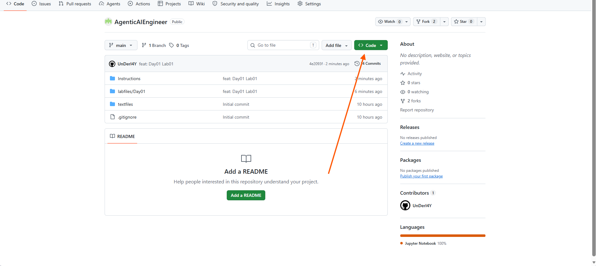

---
lab:
  title: Utilize prompt engineering in your app
  description: Learn how different prompt structures shape a generative AI model's response, then build a Python app to test them.
  level: 200
  duration: 30
  islab: true
  status: 'released'
---

# Utilize prompt engineering in your app

**Note:** The files used in this lab have already been updated with the required code. However, we recommend reviewing them before running the application.

How you write a prompt directly affects how an Azure OpenAI model responds. Clear instructions can guide the model's behaviour and output format, while different prompt structures can produce different responses to the same request.

In this exercise, you'll act as a developer building a document validation application. You'll explore how prompt engineering techniques influence model responses and then run a Python application that validates company documents.

This exercise takes approximately **30 minutes**.

## Prerequisites

- An active [Azure subscription](https://azure.microsoft.com/pricing/purchase-options/azure-account)
- [Python 3.12](https://www.python.org/downloads/) or later installed
- **Azure CLI** installed. [Install Azure CLI](https://aka.ms/installazurecliwindows)
- [Visual Studio Code](https://code.visualstudio.com/) installed on your local machine
- A web browser
- Basic familiarity with running commands in a terminal

# Explore Prompt Engineering Techniques

In this section, you will use the deployed model playground in Microsoft Foundry to explore how instructions, prompt structure, examples, and role definitions affect model responses.

## 1. Open the Model Playground

1. Open the [Microsoft Foundry portal](https://ai.azure.com).
2. Select your training project, then click **Home**.
3. Under **Model selection**, select **Test in playground**.
4. Ensure that **gpt-5.4-mini** appears at the top of the left pane.

The playground has two main areas:

- **Instructions:** Define the model's behaviour and response format.
- **Chat:** Submit prompts and review model responses.

## 2. Test the Default Instructions

1. In **Instructions**, verify that the following default instruction is present:

   ```text
   You are an AI assistant that helps people find information.
   ```

2. In the **Chat** pane, submit the following prompt:

   ```text
   Validate these company documents.

   Client Company Name:
   Contoso Technologies Pvt Ltd

   Company Registration Certificate:
   Company Name: Contoso Technologies Pvt Ltd

   GST Certificate:
   Company Name: Contoso Technologies Pvt Ltd
   ```

3. Review the response.

   The model should explain or summarize the information instead of returning a specific validation outcome.

## 3. Apply Specific Instructions

1. In **Instructions**, replace the default instruction with:

   ```text
   You are a document validation assistant.

   Check the following:

   1. Company Registration Certificate is present.
   2. GST Certificate is present.
   3. The client company name matches the company name on both certificates.

   Return only one of these outcomes:

   PASS
   FAIL
   MANUAL_REVIEW
   ```

2. In the **Chat** pane, submit:

   ```text
   Validate these company documents.

   Client Company Name:
   Contoso Technologies Pvt Ltd

   Company Registration Certificate:
   Company Name: Contoso Technologies Pvt Ltd

   GST Certificate:
   Company Name: Contoso Technologies Pvt Ltd

   Return only the outcome.
   ```

3. Review the response.

   The model should return a single validation outcome, such as:

   ```text
   PASS
   ```

This experiment demonstrates how specific instructions and a defined output format guide the model towards the required response.

## 4. Use Examples in Prompts (Few-Shot Prompting)

Few-shot prompting provides examples of expected inputs and outputs. These examples help the model understand the required response pattern.

The playground does not provide separate User and Assistant example fields. Therefore, you will include the examples directly in the chat prompt.

1. Keep the document validation instructions in the **Instructions** pane.
2. In the **Chat** pane, submit:

   ```text
   Validate each submission using exactly one outcome:

   PASS
   FAIL
   MANUAL_REVIEW

   Example 1:

   Client Company Name:
   Contoso Technologies Pvt Ltd

   Company Registration Certificate:
   Company Name: Contoso Technologies Pvt Ltd

   GST Certificate:
   Company Name: Contoso Technologies Pvt Ltd

   Outcome:
   PASS

   Example 2:

   Client Company Name:
   Contoso Technologies Pvt Ltd

   Company Registration Certificate:
   Company Name: Contoso Technology Pvt Ltd

   GST Certificate:
   Company Name: Contoso Technologies Pvt Ltd

   Outcome:
   FAIL

   Now validate this submission:

   Client Company Name:
   Contoso Technologies Pvt Ltd

   Company Registration Certificate:
   Company Name: Contoso Technologies Pvt Ltd

   GST Certificate:
   Company Name: Contoso Technologies Pvt Ltd

   Return only the outcome.
   ```

3. Review the response.

   The expected response is:

   ```text
   PASS
   ```

This experiment demonstrates how examples help the model follow a consistent input and output pattern.

## 5. Test Role-Based Instructions

The model's assigned role can influence how it interprets a task and generates a response. In this experiment, you will use the same prompt with two different role definitions.

1. In **Instructions**, enter the following:

   ```text
   You are an AI assistant that helps people find information.
   ```

2. In the **Chat** pane, submit:

   ```text
   Validate these company documents.

   Client Company Name:
   Contoso Technologies Pvt Ltd

   Company Registration Certificate:
   Company Name: Contoso Technologies Pvt Ltd

   GST Certificate:
   Company Name: Contoso Technologies Pvt Ltd

   Check whether both certificates are present and whether their company names match the client company name.
   ```

3. Review the response.
4. In **Instructions**, replace the previous instruction with:

   ```text
   You are a document validation assistant helping validate company documents for a fictional credit-risk assessment.
   ```

5. Submit the **same prompt** again.
6. Review and compare both responses.

Observe how changing the model's role provides a different context for interpreting the same request.

## 6. Restore the Default Instructions

1. In **Instructions**, restore the original instruction:

   ```text
   You are an AI assistant that helps people find information.
   ```

# Prepare the application

## 1. Clean Up Previous Downloads

Before downloading the latest repository version, remove the previous downloaded files and extracted folders to avoid using an outdated copy.

1. Open your **Downloads** folder.
2. Delete the previously downloaded `AgenticAIEngineer-main.zip` file.
3. Delete the previously extracted `AgenticAIEngineer-main` folder and any duplicate extracted folders, such as `AgenticAIEngineer-main (1)`.
4. Make sure the old copies have been removed before proceeding.

> **Note:** The repository has been updated. Using an older ZIP file or extracted folder may result in outdated files or incorrect paths when following the commands in this lab.

## 2. Download and Extract the Latest Repository

1. Open the [AgenticAIEngineer GitHub repository](https://github.com/Kiran-255666/AgenticAIEngineer).
2. Select the green **<> Code** button.
3. Select **Download ZIP**.

   

4. Wait for the download to finish.
5. Open your **Downloads** folder.
6. Right-click the downloaded ZIP file and select **Extract All**.
7. Extract the ZIP file into the **Downloads** folder.

   After extraction, you should have a folder named `AgenticAIEngineer-main` in Downloads.

## 3. Copy the Lab Folder to the Desktop

1. Open PowerShell.
2. Run the following command to copy the lab folder to your Desktop.

   ```powershell
   Copy-Item "$env:USERPROFILE\Downloads\AgenticAIEngineer-main\labfiles\Day03\lab01-byod-openai" "$env:USERPROFILE\Desktop\lab01-byod-openai" -Recurse
   ```

   **Note:** The path above assumes the extracted repository contains `labfiles\Day03\lab01-byod-openai`. If the folder structure is different, verify the extracted location in Downloads and update the source path accordingly.

3. Open the copied folder in Visual Studio Code:

   ```powershell
   code "$env:USERPROFILE\Desktop\lab01-byod-openai"
   ```

## 4. Install the Required Packages

In the VS Code terminal, create and activate a Python virtual environment, then install the required dependencies:

```powershell
python -m venv labenv
.\labenv\Scripts\Activate.ps1
pip install -r requirements.txt
```

> **Note:** If `python -m venv labenv` returns an error in the virtual machine, use the Windows Python Launcher instead:

```powershell
py -m venv labenv
.\labenv\Scripts\Activate.ps1
pip install -r requirements.txt
```

# Configure Your Application

1. In Visual Studio Code, open the `.env` file in the lab folder.

2. The following configuration is already provided for you, with `AZURE_OPENAI_ENDPOINT` and `AZURE_OPENAI_DEPLOYMENT` preconfigured.

   ```env
   AZURE_OPENAI_ENDPOINT=https://hakunamatata1234.openai.azure.com/openai/v1
   AZURE_OPENAI_API_KEY=your_azure_openai_api_key
   AZURE_OPENAI_DEPLOYMENT=gpt-5.4-mini
   ```

3. Replace the placeholder with the actual value from your Azure OpenAI resource:

   - `AZURE_OPENAI_API_KEY`: Your Azure OpenAI API key.

   **Important:** Keep your Azure OpenAI API key private. Never share it or commit the `.env` file to a public repository.

4. Open `prompt_engineering.py` and review the main functions.

   The application automatically loads Azure OpenAI settings from the `.env` file. You do not need to enter the endpoint, API key, or deployment name directly in the Python code.

   **a. Configuration and initialization**

   ```python
   async def main() -> None:
       raw_endpoint = get_required_environment_variable("AZURE_OPENAI_ENDPOINT")
       endpoint = normalize_endpoint(raw_endpoint)
       api_key = get_required_environment_variable("AZURE_OPENAI_API_KEY")
       deployment = get_required_environment_variable("AZURE_OPENAI_DEPLOYMENT")

       validate_configuration(endpoint, api_key, deployment)

       client = AsyncOpenAI(api_key=api_key, base_url=endpoint)
   ```

   **What it does:** Retrieves Azure OpenAI settings from `.env`, validates the configuration, and initializes the asynchronous client.

   **b. Read system instructions and grounding rules**

   ```python
   system_text = read_text_file(SYSTEM_FILE)
   grounding_text = read_text_file(GROUNDING_FILE)
   ```

   **What it does:** Loads the assistant's behaviour instructions and the business rules used for document validation.

   **c. Collect and validate user input**

   ```python
   user_text = collect_case_from_prompts()

   is_valid, validation_message = validate_user_input(user_text)
   ```

   **What it does:** Collects company and document details and checks whether the input is valid.

   **d. Build the grounded prompt**

   ```python
   grounded_user_message = build_grounded_user_message(
       grounding_text,
       user_message
   )
   ```

   **What it does:** Combines grounding rules with user-provided document details and ensures document content is treated as untrusted data.

   **e. Send the request to Azure OpenAI**

   ```python
   response = await client.chat.completions.create(
       model=model,
       messages=[
           {"role": "system", "content": system_message},
           {"role": "user", "content": grounded_user_message}
       ],
       max_completion_tokens=1000
   )
   ```

   **What it does:** Sends the system instructions and grounded user prompt to the configured Azure OpenAI deployment and retrieves the response.

   **f. Display the model response**

   ```python
   answer = response.choices[0].message.content

   print(answer.strip())
   ```

   **What it does:** Extracts and displays the document validation result returned by the model.

**5. Review `system.txt` and `grounding.txt`.** These files are provided and contain the instructions and validation rules used by the application.

### a. `system.txt` – System Instructions

Defines how the AI assistant should behave and respond.

Review the following:

- **Role and scope:** Defines the assistant's role and limits its tasks to document presence and company name validation.
- **Scope control:** Prevents the assistant from performing credit scoring, financial analysis, MCA lookup, or other out-of-scope operations.
- **Evidence rules:** Restricts the assistant to information supplied in the user's current message.
- **Document security:** Treats document content as untrusted input and prevents embedded instructions from overriding system instructions.
- **Name comparison:** Defines how company names should be compared.
- **Status and output format:** Specifies the `PASS`, `FAIL`, and `MANUAL_REVIEW` statuses and the required response structure.

### b. `grounding.txt` – Grounding Knowledge Base

Contains the business rules and validation logic that guide the document-validation process.

Review the following:

- **Required documents:** Company Registration Certificate and GST Certificate.
- **Document states:** `PRESENT_READABLE`, `PRESENT_UNREADABLE`, `PRESENT_AMBIGUOUS`, and `MISSING`.
- **Safe normalisation:** Defines permitted text normalisation rules before comparing company names.
- **Comparison rules:** Defines how the client name and certificate names must match.
- **Status precedence:** Establishes the priority of `FAIL`, `MANUAL_REVIEW`, and `PASS`.
- **Reason codes:** Defines the reason codes for missing documents, unreadable certificates, and company name mismatches.
- **Examples:** Provides sample PASS, FAIL, and MANUAL_REVIEW scenarios.

**Key distinction:**
- `system.txt` defines **how the AI should behave and respond**.
- `grounding.txt` defines **which business rules the AI must follow when validating documents**.

6. Save your changes using **Ctrl + S**.

# Run the Application

Run the following command in the VS Code terminal:

```powershell
python prompt_engineering.py
```

Select **option 1** when prompted. The application will ask for the client name and the state of each document.

Use the following shortcuts when entering document states:

| Shortcut | Meaning |
| --- | --- |
| PR | Present and readable |
| PU | Present but unreadable |
| PA | Present but unclear |
| MI | Missing |

# Example Scenarios

## Scenario 1: Matching Company Names

Enter the following values when prompted:

```text
Client company name:
> Contoso Technologies Pvt Ltd

Registration Certificate (PR/PU/PA/MI):
> PR

Registration Certificate company name:
> Contoso Technologies Pvt Ltd

GST Certificate (PR/PU/PA/MI):
> PR

GST Certificate company name:
> CONTOSO TECHNOLOGIES PVT LTD
```

**Expected result:** `PASS`

The names match after safe normalisation, which ignores differences such as letter case.

## Scenario 2: Company Name Mismatch

Enter the following values when prompted:

```text
Client company name:
> Contoso Technologies Pvt Ltd

Registration Certificate (PR/PU/PA/MI):
> PR

Registration Certificate company name:
> Contoso Technology Pvt Ltd

GST Certificate (PR/PU/PA/MI):
> PR

GST Certificate company name:
> Contoso Technologies Pvt Ltd
```

**Expected result:** `FAIL, COMPANY_NAME_MISMATCH`

"Technology" and "Technologies" are different words, so the names do not match after safe normalisation.

## Scenario 3: Unreadable Document

Enter the following values when prompted:

```text
Client company name:
> Contoso Technologies Pvt Ltd

Registration Certificate (PR/PU/PA/MI):
> PU

GST Certificate (PR/PU/PA/MI):
> PR

GST Certificate company name:
> Contoso Technologies Pvt Ltd
```

**Expected result:** `MANUAL_REVIEW, UNREADABLE_REGISTRATION_CERTIFICATE`

The Registration Certificate is present but unreadable. Therefore, the company name cannot be verified, and the case is sent for manual review.

# Prompt Engineering Techniques Used in This Lab

This lab demonstrated how different prompt engineering techniques can be combined to improve the consistency, reliability, and accuracy of AI-generated responses.

| Technique | How It Was Used | Purpose |
| --- | --- | --- |
| **System Prompting** | `You are a document validation assistant.` | Defines the model's role, behaviour, and expected responsibilities. |
| **Instruction Prompting** | `Check the following... Return only one of these outcomes...` | Provides clear, task-specific instructions. |
| **Structured Output Prompting** | `Return only the outcome.` | Restricts the response to a predefined format for greater consistency. |
| **Few-Shot Prompting** | PASS and FAIL validation examples. | Demonstrates the expected behaviour through examples before presenting a new scenario. |
| **Role-Based Prompting** | `You are a document validation assistant helping validate company documents...` | Provides business context and narrows the model's focus to a specific domain. |
| **Contextual Grounding** | Company names, registration certificates, and GST certificates. | Supplies the information required for the model to perform the validation task. |
| **Task Decomposition** | Checking certificate presence, comparing names, and returning an outcome. | Breaks a task into smaller logical steps, making it easier for the model to follow. |

## What You Learned

In this lab, you explored how prompt design directly influences model behaviour. By combining instructions, examples, contextual information, output constraints, and role definitions, you can guide a model to produce more consistent, reliable, and predictable results for business scenarios.

# Additional Prompting Techniques

The following prompting techniques are commonly used when designing generative AI applications:

| Technique | Description | Example |
| --- | --- | --- |
| **Zero-Shot Prompting** | Performs a task using instructions only, without providing examples. | `Summarize this document in three bullet points.` |
| **One-Shot Prompting** | Provides a single example before asking the model to perform a task. | Show one classification example before asking the model to classify a new item. |
| **Few-Shot Prompting** | Provides multiple examples before requesting a response. | PASS and FAIL validation examples. |
| **Chain-of-Thought Prompting** | Encourages the model to work through a problem in a structured way. | `Work through the validation criteria and provide a concise explanation of the result.` |
| **Role-Based Prompting** | Assigns a specific role or area of expertise to the model. | `You are a financial analyst.` |
| **Persona Prompting** | Defines a communication style, personality, or audience. | `Explain this as a friendly teacher.` |
| **Contextual Grounding** | Supplies supporting information that the model should use when responding. | Policies, manuals, product catalogues, or company data. |
| **Structured Output Prompting** | Requires responses in a predefined format. | JSON, XML, Markdown tables, or CSV output. |
| **Template-Based Prompting** | Uses reusable prompt templates with placeholders for dynamic content. | `Summarize {document} for {audience}.` |
| **Multi-Turn Prompting** | Maintains context across multiple interactions in a conversation. | Follow-up questions that rely on previous messages. |
| **Retrieval-Augmented Generation (RAG)** | Uses external knowledge sources to ground responses in trusted information. | Searching company policies before answering an employee question. |
| **Prompt Chaining** | Breaks a large task into multiple prompt-driven steps. | Extract data > Validate data > Generate report. |
| **Self-Consistency Prompting** | Samples multiple reasoning paths and compares their results to identify a more reliable answer. | Solving a problem through multiple sampled approaches and selecting the most consistent result. |
| **ReAct (Reason + Act)** | Combines reasoning with tool or knowledge-source usage. | An AI agent that searches the web or queries a database before responding. |
| **Tree of Thoughts (ToT)** | Explores multiple possible solution paths before selecting an approach. | Comparing several approaches to solving a business problem. |

> **Note:** This lab primarily demonstrated **System Prompting**, **Instruction Prompting**, **Structured Output Prompting**, **Few-Shot Prompting**, **Role-Based Prompting**, **Contextual Grounding**, and **Task Decomposition**. In practice, multiple prompting techniques are often combined to improve response quality, consistency, and reliability.

# Summary

In this lab, you explored how prompt design influences the behaviour and output of an Azure OpenAI model. Using Microsoft Foundry, you experimented with different prompt engineering techniques to improve the consistency and reliability of document validation responses.

You then configured and ran a Python application that uses Azure OpenAI to validate company documents. Through a series of validation scenarios, you observed how prompt engineering techniques can be applied to business workflows to produce more reliable, consistent, and predictable outcomes.

By the end of this lab, you had hands-on experience with several core prompt engineering techniques and gained a better understanding of how prompt design influences the quality and format of AI-generated responses.