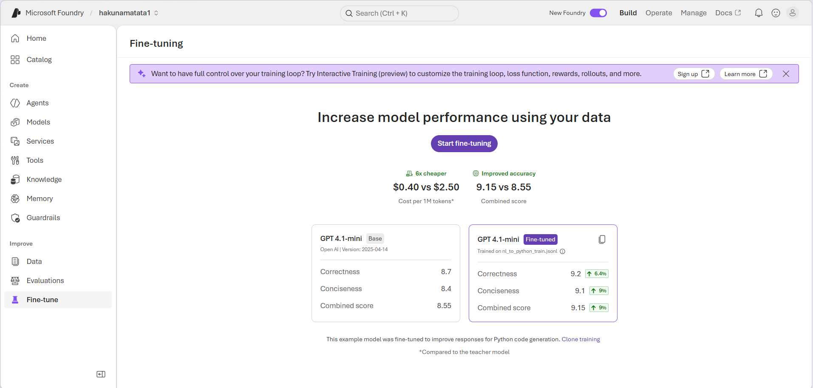
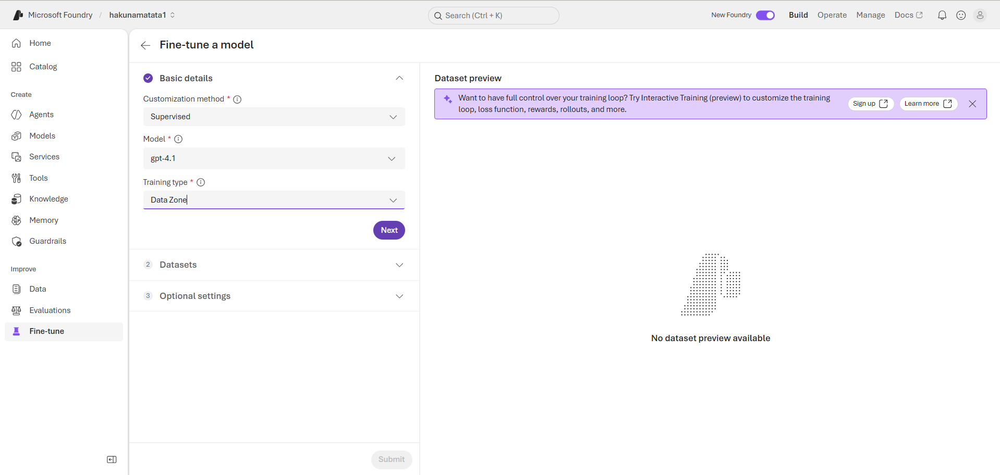
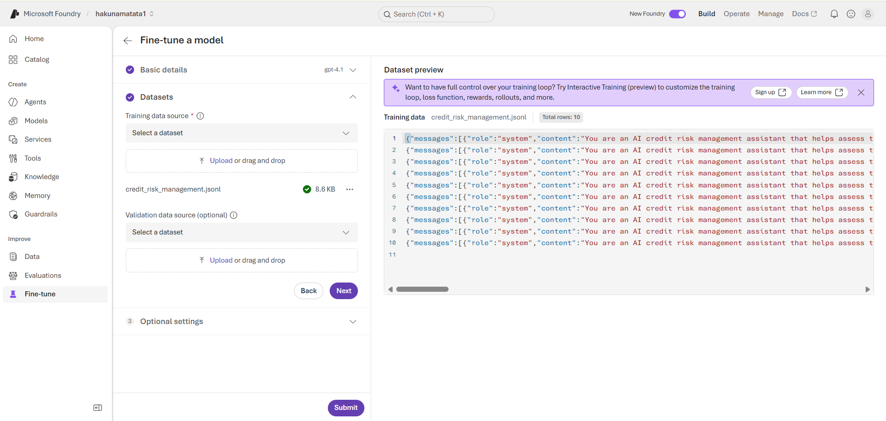
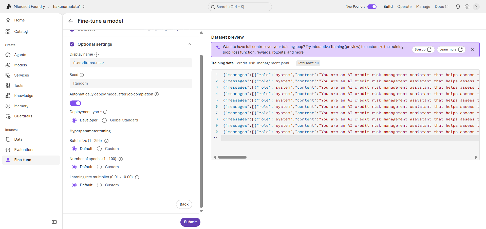
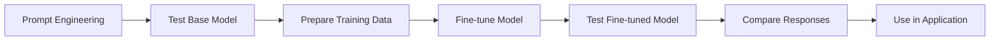
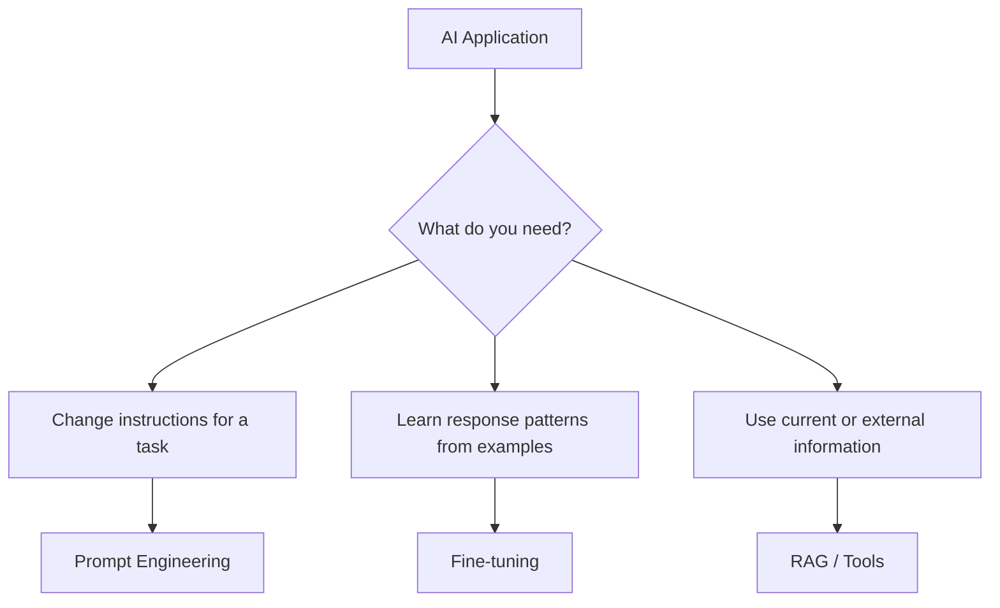

---
lab:
  title: Fine-tune a language model
  description: Learn how to use your own training data to fine-tune a model and customize its behavior.
  level: 300
  duration: 150
  islab: true
  status: 'released'
---

## Prerequisites

Before you start, ensure that you have:

- An active [Azure subscription](https://azure.microsoft.com/free/).
- A web browser.
- A Microsoft Foundry project prepared by your trainer or lab environment.
- The **`gpt-5.4-mini`** model available for the initial playground test.
- The **`gpt-4.1`** model available for supervised fine-tuning.
- Permission to create fine-tuning jobs and upload datasets.

# Fine-tune a language model

Before exploring fine-tuning, let's recap **Prompt Engineering**.

**Prompt engineering** is the process of writing instructions (prompts) that guide a language model's responses. For example, you can instruct a model: "Act as a credit analyst and explain your decision with the key factors." The model uses these instructions to generate a response. This process does not change the model's trained parameters.

**Fine-tuning** is the process of training a pre-trained language model further with a custom dataset. The dataset contains example inputs and the expected outputs. During training, the model updates its parameters to learn patterns from these examples. This can help the model produce more consistent responses for a specific task.

### Real-world example

Imagine a bank wants to build a **credit risk management assistant** to review business loan applications.

The bank can prepare a training dataset with examples that show how to:

- **Review company documents:** Extract and check business information.
- **Check compliance requirements:** Identify whether an application meets regulatory and internal requirements.
- **Evaluate financial ratios:** Assess profitability, liquidity, and debt levels.
- **Review credit history:** Identify previous defaults and repayment patterns.
- **Assess industry risk:** Identify risks related to the applicant's industry.

For example, a loan application may not contain all the required financial information. The training dataset can include an example where the correct response identifies the missing information instead of making assumptions.

In this exercise, you will fine-tune a language model to build a **credit risk management assistant**. You will then compare its responses with those of the base model.

## What you will do

1. **Test the prepared `gpt-5.4-mini` model** in the playground. Observe how different instructions affect its responses.
2. **Create a supervised fine-tuning job** with `gpt-4.1` and the provided training data. This step is optional because a prepared fine-tuned model is already available.
3. **Review the training data** used for fine-tuning.
4. **Test the prepared fine-tuned model** and compare its responses with the base model.

The goal is to understand how training examples can influence a model's response patterns and make its behavior more consistent for a specific task.

> [!NOTE]
> This exercise takes approximately **150 minutes** if you choose to create your own fine-tuned model. The fine-tuning job itself may take approximately **120–140 minutes** to complete, including training and model preparation. Therefore, we highly recommend using the **already fine-tuned model** provided in this lab to complete the exercise without waiting for a new model to be trained and deployed.

## Open the existing project

Open the [Microsoft Foundry portal](https://ai.azure.com) and ensure that you are in the `hakunamatata` project.

## Download the training data

1. Open the [training dataset](https://github.com/Kiran-255666/AgenticAIEngineer/blob/main/labfiles/Day04/lab02-fine-tuning/credit_risk_management.jsonl) in a browser.
2. Download the file and save it locally as `credit_risk_management.jsonl`.

> **Important:** Your browser may save the file with a `.txt` extension. If it does, rename the file so that it ends with `.jsonl`.

## Choose your learning path

A prepared fine-tuned model is already available in the project. You can use it to complete this lab without creating another fine-tuning job.

Choose how you want to proceed:

- **Understand the fine-tuning workflow:** We strongly recommend that you carefully read through [Start a fine-tuning job (Optional)](#start-a-fine-tuning-job-optional) to understand how fine-tuning is performed.

- **Create your own fine-tuned model:** Follow the steps as instructed [Start a fine-tuning job (Optional)](#start-a-fine-tuning-job-optional).

## Start a fine-tuning job (Optional)

1. In the Foundry portal, select **Fine-tune** from the left navigation.

   

2. Select **Start fine-tuning**.
3. In **Basic details**, configure the job as follows:

   - **Customization method:** Supervised
   - **Model:** `gpt-4.1`
   - **Training type:** Data Zone

   

4. Select **Next**.
5. In **Datasets**, under **Training data source**, select **Upload or drag and drop**.
6. Upload `credit_risk_management.jsonl`.
7. Confirm that the upload finishes and that the Dataset preview displays the file content and JSONL rows.
8. Leave **Validation data source (optional)** empty.

   

9. Select **Next** to open **Optional settings**.
10. Configure these settings:

    - **Display name:** Keep the generated name, or enter `ft-credit-<your-preferred-suffix>`.
    - **Seed:** Keep the default value, **Random**.
    - **Automatically deploy model after job completion:** Turn this **on**.
    - **Deployment type:** **Developer**.
    - Ensure that **Default** is selected for **Batch size**, **Number of epochs**, and **Learning-rate multiplier**.

    

11. Select **Submit** to start the fine-tuning job.

> **Note:** Fine-tuning and deployment can take approximately **120–140 minutes**. You do not need to wait for the job to finish before continuing with the playground testing.

## Test the base model in the playground

> **Tip:** Keep a copy of the prompts and model responses in Notepad. You will use them later to compare the base model with the fine-tuned model.

Whether you submitted a new fine-tuning job or skipped it, begin by testing the prepared base model (`gpt-5.4-mini`) in the playground.

This provides a baseline for comparing how the base model responds before and after fine-tuning.

1. Open the model playground for **`gpt-5.4-mini`**.
2. In the chat pane, enter:

   ```text
   What can you do?
   ```

3. Review the response. It may be general because you have not provided task-specific instructions.
4. In the **Instructions** field, enter:

   ```text
   You are an AI assistant that helps assess the creditworthiness of business clients.
   ```

5. Ask the same question again:

   ```text
   What can you do?
   ```

6. Compare this response with the previous one. The model may now focus more on business credit assessment. However, its behavior is still based on the instructions you provided.
7. Replace the instructions with the following detailed credit risk prompt:

   ```text
   You are an AI credit risk management assistant that helps assess the creditworthiness of business clients. Your objective is to evaluate company documents, compliance status, financial ratios, external credit information, and industry risk using the provided credit risk assessment rules.

   Do not invent missing financial or compliance information.

   Clearly identify missing documents or data and explain how they affect the assessment.
   ```

8. Test the model with the following questions. For each response, record the **answer, tone, and writing style in Notepad**. You will use these responses later when testing the fine-tuned model.

   **Question 1**

   ```text
   What documents are required to start a credit risk assessment?
   ```

   **Question 2**

   ```text
   The client uploaded only the GST Certificate. Can we pass the document verification step?
   ```

   **Question 3**

   ```text
   A company has a Current Ratio of 1.56, Debt-to-Equity of 1.86, and Net Profit Margin of 5.56%. How many points does it receive for these three financial metrics?
   ```

   **Question 4**

   ```text
   How does industry risk affect the credit score?
   ```

   **Question 5**

   ```text
   What happens if a sanctions or compliance match is confirmed?
   ```

9. Keep the responses in Notepad. You will compare these **`gpt-5.4-mini` base-model responses** with the responses from the **fine-tuned model** later in the lab.

## Review the training data

The training file contains examples of the response patterns that you want the fine-tuned model to learn.

1. Open the downloaded `credit_risk_management.jsonl` file in a text editor.
2. Review the JSONL entries. The first entry should look similar to the following example, formatted for readability:

   ```json
   {
     "messages": [
       {
         "role": "system",
         "content": "You are an AI credit risk management assistant that helps assess the creditworthiness of business clients. Your objective is to evaluate company documents, compliance status, financial ratios, external credit information, and industry risk using the provided credit risk assessment rules. Do not invent missing financial or compliance information. Clearly identify missing documents or data and explain how they affect the assessment."
       },
       {
         "role": "user",
         "content": "What documents are required to start a credit risk assessment?"
       },
       {
         "role": "assistant",
         "content": "The assessment requires both the Company Registration Certificate and GST Certificate. The company name must match exactly across the client information and both certificates. The assessment should also verify the company's legal status, sanctions or adverse compliance records, financial statements for the last two financial years, and the latest external credit score or rating."
       }
     ]
   }
   ```

Each entry contains three message types:

- **System message:** Defines the assistant's role and instructions.
- **User message:** Contains a credit-risk-related question.
- **Assistant message:** Contains the expected response to that question.

These examples form the supervised training data. During fine-tuning, the model learns patterns from the input and expected output pairs. These patterns can influence its terminology, response structure, and approach to credit risk questions.

> **Note:** Fine-tuning can influence response patterns and behavior. It does not replace a knowledge base or retrieval system when an application needs frequently changing or authoritative information.

## Test the fine-tuned model

- **If you created your own fine-tuning job:** Wait until your fine-tuned model has finished training and deployment. Then, use the model created by your job to continue with the lab.

- **If you skipped the optional fine-tuning job:** Use the prepared fine-tuned model.

Follow the steps below to open the model and test it using the same instructions and questions from the base-model testing section.

1. In the left navigation, select **Models**.

2. Find and click the prepared fine-tuned model named:

   ```text
   25-04-14-ft-2b1542e1167844c4a875c813c9344c89-ft-credit-test-user
   ```

3. Open the fine-tuned model in the **model playground**.

4. In the **Instructions** field, enter the **same credit risk management prompt** that you used when testing the base model:

   ```text
   You are an AI credit risk management assistant that helps assess the creditworthiness of business clients. Your objective is to evaluate company documents, compliance status, financial ratios, external credit information, and industry risk using the provided credit risk assessment rules.

   Do not invent missing financial or compliance information.

   Clearly identify missing documents or data and explain how they affect the assessment.
   ```

5. Ask the **same five questions** to the fine-tuned model (`gpt-4.1`).

   **Question 1**

   ```text
   What documents are required to start a credit risk assessment?
   ```

   **Question 2**

   ```text
   The client uploaded only the GST Certificate. Can we pass the document verification step?
   ```

   **Question 3**

   ```text
   A company has a Current Ratio of 1.56, Debt-to-Equity of 1.86, and Net Profit Margin of 5.56%. How many points does it receive for these three financial metrics?
   ```

   **Question 4**

   ```text
   How does industry risk affect the credit score?
   ```

   **Question 5**

   ```text
   What happens if a sanctions or compliance match is confirmed?
   ```

6. Compare the fine-tuned model responses with the **base-model responses saved in Notepad**.

   Look for differences in:

   - **Response consistency**
   - **Tone and writing style**
   - **Adherence to the credit risk instructions**
   - **Use of the defined credit risk assessment rules**
   - **Handling of missing information**
   - **Accuracy and completeness of the responses**

> **Tip:** Use the responses you saved in Notepad as a direct reference. This makes it easier to identify changes in response behavior after fine-tuning.

## Conclusion

In this lab, you learned how **fine-tuning** can influence the behavior of a language model for a specific use case.

You first tested **`gpt-5.4-mini`** in the playground. You used different instructions to see how they affected the model's responses.

You then reviewed a **credit risk management dataset** in JSONL format. If you completed the optional step, you also used the dataset to create a supervised fine-tuning job for **`gpt-4.1`**.

Finally, you tested the prepared fine-tuned model with the same credit risk questions. You compared its responses with the **`gpt-5.4-mini`** responses saved in Notepad.

The overall workflow can be summarized as follows:



The main takeaway is that **prompt engineering** and **fine-tuning** serve different purposes:



Fine-tuning can help a model learn **task-specific response patterns, terminology, output formats, and behaviors** from examples.

You can use fine-tuning for tasks such as:

- Customer support response generation.
- Document classification and processing.
- Structured data extraction.
- Coding assistants.
- Internal business workflows.

The right approach depends on the application's requirements. Consider the type of data, how often the information changes, expected performance, cost, and operational complexity.

You can use **prompt engineering, RAG, tools, fine-tuning, or a combination of these approaches**:

- **Prompt engineering** → Provides instructions for how the model should respond.
- **Fine-tuning** → Trains the model to follow patterns from examples.
- **RAG** → Provides relevant external or frequently changing information to the model.
- **Tools** → Allow the model to interact with external systems or perform actions.

> **Key takeaway:** Fine-tuning is not simply a way to give a model more information. It trains the model to follow patterns in example data. For current or frequently changing information, approaches such as **RAG or tools** may be more appropriate.

By completing this lab, you explored how to prepare training examples, start a fine-tuning job, test a base model, review training data, test a fine-tuned model, and compare the resulting responses.