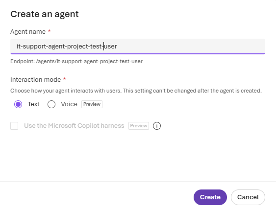
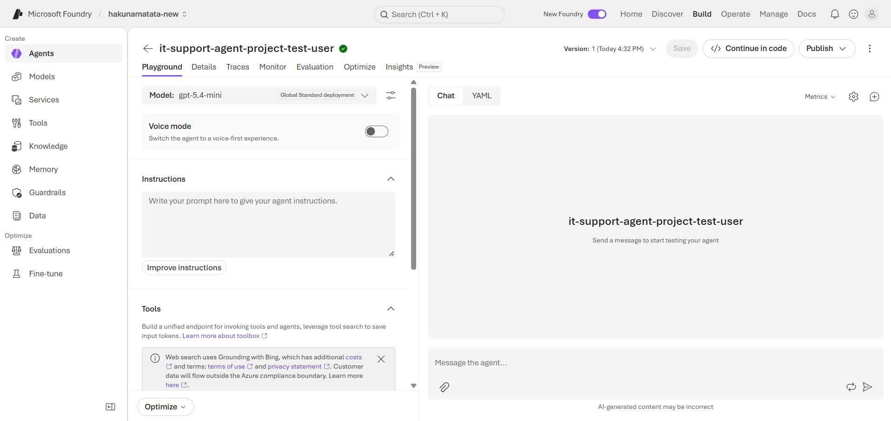
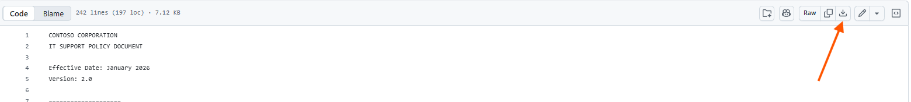
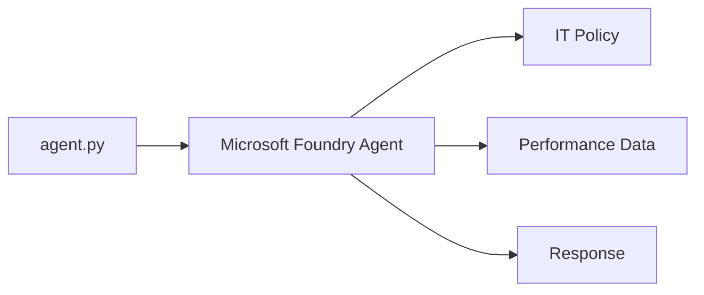
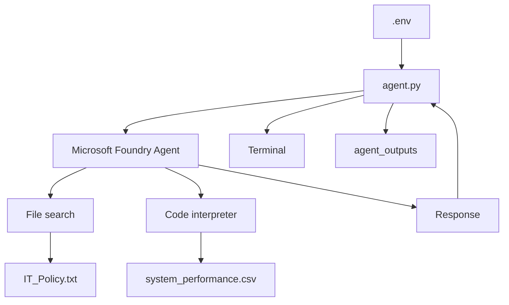
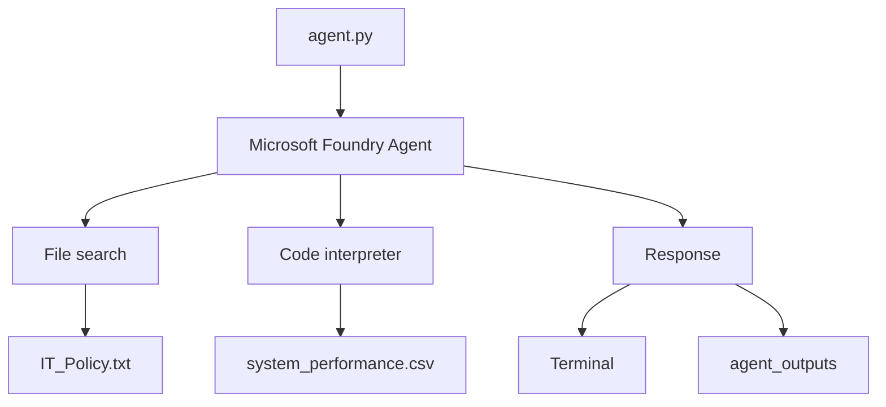

---
lab:
    title: 'Build and use AI agents with Microsoft Foundry'
    description: 'Create an AI agent using the Microsoft Foundry portal, configure built-in tools like file search and code interpreter, and interact with the agent programmatically using Python in Visual Studio Code'
    level: 300
    duration: 45
    islab: true
    status: 'released'
---

# Build and use AI agents with Microsoft Foundry portal

In this exercise, you'll build a complete AI agent solution using both the Microsoft Foundry portal and the Foundry Toolkit VS Code extension. You'll start by creating a basic agent in the portal with grounding data and built-in tools, then interact with it programmatically using VS Code to use advanced capabilities like code interpreter for data analysis.

This exercise takes approximately **45** minutes.

## Prerequisites

Before starting this exercise, ensure you have:

- An [Azure subscription](https://azure.microsoft.com/free/) with sufficient permissions and quota to provision Azure AI resources
- [Visual Studio Code](https://code.visualstudio.com/) installed on your local machine
- [Python 3.12](https://www.python.org/downloads/) installed
- [Git](https://git-scm.com/downloads) installed on your local machine
- Basic familiarity with Azure AI services and Python programming

> [!IMPORTANT]
> The Microsoft Foundry project, resource, region, subscription, and deployed model have been provisioned for this exercise. Please use the provided configuration and proceed with configuring the agent. No additional project, resource, or model setup is required.

### Create an Agent

1. Return to [**https://ai.azure.com/**](https://ai.azure.com/).

2. Click on **Home**, locate the **Create an agent** section.

3. Click **Create an agent**, a dialog box will appear there enter a unique name for your agent. For example, use **`it-support-agent-project-<youruniquesuffix>`**, replace `<youruniquesuffix>` with your unique suffix. 

   

4. Under **Interaction mode**, make sure **Text** is selected.

5. Select **Create**.

6. Wait for the agent to be created. After a few moments, the agent authoring canvas will open, where you can configure the agent's instructions, tools, and knowledge sources.

   

> [!TIP]
> Remember your agent's name, as you will need it in the upcoming lab.

## Configure the Agent with Instructions and Grounding Data

Your agent has been created, and the **Agent's playground** is now open. In this section, you'll configure the agent's instructions, add grounding data, and enable built-in tools for file search and data analysis.

1. In the **Agent's playground**, locate the **Instructions** section and enter the following instructions:

   ```prompt
   You are an IT Support Agent for Contoso Corporation.

   You help employees with technical issues and IT policy questions.

   Guidelines:

   - Always be professional and helpful
   - Use the IT policy documentation to answer questions accurately
   - If you don't know the answer, admit it and suggest contacting IT support directly
   - When creating tickets, collect all necessary information before proceeding
   ```

2. Download the IT policy document from the training repository. Open a new browser tab and enter the following URL in the address bar:

   **https://github.com/Kiran-255666/AgenticAIEngineer/blob/main/labfiles/Day04/lab03-build-and-use-agent/IT_Policy.txt**

   On the file page, select **Download raw file** to download `IT_Policy.txt` to your local **Downloads** folder.
   
   

> [!NOTE]
> The document contains sample IT policies for password resets, software installation requests, and hardware troubleshooting.

3. Download the system performance data file from the training repository. Open a new browser tab and enter the following URL in the address bar:

   **https://github.com/Kiran-255666/AgenticAIEngineer/blob/main/labfiles/Day04/lab03-build-and-use-agent/system_performance.md**

   On the file page, select **Download raw file** to download `system_performance.md` to your local **Downloads** folder.

> [!NOTE]
> The .md file contains simulated system metrics, including CPU, memory, and disk usage over time, which the agent can analyze.

4. Return back to **Playground** click **Add** then click **Code interpreter**

5. Select **Add**, select **Add tools**, choose **File search**, and then select **Add tool**.

6. An **Attach files** dialog box will appear. Leave the **Index** option set to its default value (**Create a new index**). In the **Vector index name** field, replace auto-generated **Vector index name** with `index_<your_unique_suffix>`. Description is optional. Select **Browse for files**, navigate to the **Downloads** folder, select both `IT_Policy.txt` and `system_performance.md`.

7. Wait for the file to finish indexing. When the file status changes to Success, select **Attach** to add the vector index to your agent click **save** you can find at the top.

## Test your agent

1. In the chat interface on the right side of the playground, enter the following prompt:

   ```text
   What's the policy for password resets?
   ```

2. Review the generated response and observe how the agent answers the question.

3. Next, enter a more specific prompt:

   ```text
   What are the password requirements for employees?
   ```

4. Review the response and compare it with the previous answer. Observe how the agent provides a more focused response based on the specific question. The generated responses may vary slightly in your case.

5. Test **Code interpreter** with the following data analysis request:

   ```text
   Can you analyze the system performance data and identify any concerning trends?
   ```

6. Review the response and observe how the agent analyzes the system performance data to identify relevant patterns and potential performance concerns. The results may vary depending on the available data.

7. Ask a follow-up question:

   ```text
   Which system appears to have the highest average CPU usage?
   ```

8. Review the response and observe how the agent performs additional analysis to answer the follow-up question. The results may vary depending on the available data.

Your agent is now configured with grounding data and the available tools. Now you'll use this agent with Visual Studio Code.

## Get the application files from GitHub

### 1. Clean Up Previous Downloads 

Before downloading the latest repository version, remove the previous downloaded files and extracted folders to avoid using an outdated copy.

1. Open your **Downloads** folder.
2. Delete the previously downloaded `AgenticAIEngineer-main.zip` file.
3. Delete the previously extracted `AgenticAIEngineer-main` folder and any duplicate extracted folders, such as `AgenticAIEngineer-main (1)`.
4. Make sure the old copies have been removed before proceeding.

> **Note:** The repository has been updated. Using an older ZIP file or extracted folder may result in outdated files or incorrect paths when following the commands in this lab.

### 2. Download and Extract the Latest Repository

The application files for the Credit Risk RAG application are provided in the [training repository](https://github.com/Kiran-255666/AgenticAIEngineer).

1. Open the [training repository](https://github.com/Kiran-255666/AgenticAIEngineer) in a browser.

2. Select **Code** and then select **Download ZIP**.

3. Once the ZIP file has downloaded, open the **Downloads** folder.

4. Right-click the ZIP file and select **Extract All**.

   > **Important:** Do not run the application directly from the deeply nested extracted folder in `Downloads`. The long Windows path can cause path-related problems in the VM.

5. After extracting the repository, open **PowerShell**.

6. Copy the Lab 3 folder to your Desktop:

   ```powershell
   Copy-Item "$env:USERPROFILE\Downloads\AgenticAIEngineer-main\AgenticAIEngineer-main\labfiles\Day04\lab03-build-and-use-agent" "$env:USERPROFILE\Desktop\lab03" -Recurse
   ```

7. Open the copied Lab 3 folder in Visual Studio Code:

   ```powershell
   code "$env:USERPROFILE\Desktop\lab03"
   ```

> [!NOTE]
> The folder is copied to the Desktop to avoid issues with long file paths. The Lab 2 codebase is now open in Visual Studio Code.

## Understand the lab files

The `Python` folder contains the files needed to run the application.

```text
Python
├── .env
├── agent.py
└── requirements.txt
```

The lab folder also contains these supporting files:

```text
IT_Policy.txt
system_performance.csv
```

Here is what each file is used for:

* **`.env`** stores the Microsoft Foundry project endpoint and the name of your agent.
* **`agent.py`** contains the Python application that connects to your agent, sends your questions, and displays the responses.
* **`requirements.txt`** lists the Python packages required by the application.
* **`IT_Policy.txt`** contains the Contoso Corporation IT policies used by the agent for policy questions.
* **`system_performance.csv`** contains system performance data that the agent can analyze with **Code interpreter**.

The basic flow is:



When you ask about an IT policy, the agent can use **File search** to find information in the policy document. When you ask about the performance data, it can use **Code interpreter** to analyze the CSV file.

> [!IMPORTANT]
> Use the agent you created recently.

## Review the Python application

The `agent.py` file already contains the application code. You don't need to write or change the code.

Review the sections below to see how the application connects to Microsoft Foundry, sends requests to your agent, and handles the results.

### Load the configuration

The application first loads the values from `.env`.

```python
load_dotenv()

project_endpoint = os.environ.get("PROJECT_ENDPOINT")
agent_name = os.environ.get("AGENT_NAME", "it-support-agent")
```

`load_dotenv()` reads the values from the `.env` file.

The application then reads:

* `PROJECT_ENDPOINT` for the Microsoft Foundry project.
* `AGENT_NAME` for the agent created recently.

This keeps the project and agent settings outside the Python code.

### Connect to Microsoft Foundry

The application creates an Azure credential and a project client.

```python
credential = DefaultAzureCredential()

project_client = AIProjectClient(
    credential=credential,
    endpoint=project_endpoint
)
```

`DefaultAzureCredential()` uses your Azure sign-in to authenticate the application.

`AIProjectClient` uses that credential and the project endpoint to connect to Microsoft Foundry.

### Get the existing agent

The application gets your agent by name.

```python
agent = project_client.agents.get(agent_name=agent_name)

print(f"Connected to agent: {agent.name} (id: {agent.id})")
```

The value in `AGENT_NAME` tells the application which agent to load.

The `get()` method retrieves that existing agent. It does not create a new one.

### Create a conversation

The application creates a conversation for your interaction with the agent.

```python
conversation = openai_client.conversations.create(items=[])

print(f"Conversation created (id: {conversation.id})")
```

The conversation keeps your messages together while the application is running.

The same conversation is used for each question you enter.

### Read your questions

The application waits for you to enter a question.

```python
while True:
    user_input = input("You: ").strip()

    if user_input.lower() in ['exit', 'quit', 'bye']:
        print("Goodbye!")
        break

    if not user_input:
        continue
```

The `while True` loop keeps accepting questions.

If you enter `exit`, `quit`, or `bye`, the application stops.

If you press Enter without entering text, the application waits for the next input.

### Add the question to the conversation

After you enter a question, the application adds it to the conversation.

```python
openai_client.conversations.items.create(
    conversation_id=conversation.id,
    items=[
        {
            "type": "message",
            "role": "user",
            "content": user_input
        }
    ]
)
```

The text you enter is stored as a user message in the current conversation.

For example:

```text
What's the policy for password resets?
```

### Send the request to the agent

The application then asks the agent to respond.

```python
response = openai_client.responses.create(
    conversation=conversation.id,
    extra_body={
        "agent_reference": {
            "name": agent.name,
            "type": "agent_reference"
        }
    },
    input=""
)
```

The `agent_reference` identifies the agent that should handle the conversation.

The agent can use the instructions and tools configured recently.

A policy question can use **File search**, while a data analysis request can use **Code interpreter**.

### Display the agent response

The application checks the response and prints the text in the terminal.

```python
if item_type == "message" and getattr(item, "content", None):
    for content_item in item.content:
        if getattr(content_item, "type", "") != "output_text":
            continue

        formatted_text, message_files = format_output_text(
            content_item,
            openai_client,
            downloaded_files,
        )

        if formatted_text:
            print(f"\nAgent: {formatted_text}\n")
```

The code looks for text in the response and prints it with the `Agent:` label.

For example:

```text
You: What's the policy for password resets?

Agent: [Agent response]
```

The response depends on the question and the information available to the agent.

### Save generated files

The application creates an `agent_outputs` folder for files generated by the agent.

```python
OUTPUT_DIR = Path("agent_outputs")
```

The `get_output_path()` function creates a file path for each generated file.

```python
def get_output_path(filename):
    OUTPUT_DIR.mkdir(exist_ok=True)
    file_name = Path(filename).name
    stem = Path(file_name).stem or "output"
    suffix = Path(file_name).suffix
    output_path = OUTPUT_DIR / file_name

    counter = 1
    while output_path.exists():
        output_path = OUTPUT_DIR / f"{stem}_{counter}{suffix}"
        counter += 1

    return output_path
```

The function checks whether the file name already exists. If it does, it adds a number to the new file name instead of replacing the existing file.

### Save generated images

When the agent returns an image, `save_image()` saves it to your computer.

```python
def save_image(image_data, filename):
    return save_bytes(base64.b64decode(image_data), filename)
```

`base64.b64decode()` converts the image data into bytes. The `save_bytes()` function then writes those bytes to a file.

The image is saved in the `agent_outputs` folder.

### Download generated files

Code interpreter can also generate files that the application needs to download.

```python
def download_container_file(openai_client, annotation, downloaded_files):
    file_content = openai_client.containers.files.content.retrieve(
        file_id=annotation.file_id,
        container_id=annotation.container_id,
    )

    output_path = save_bytes(
        file_content.read(),
        annotation.filename or f"{annotation.file_id}.bin",
    )

    downloaded_files[cache_key] = output_path
    return output_path
```

This function retrieves the file from the agent's container and saves it locally.

The application can then show you where the generated file was saved.

### Complete application flow

The main parts of `agent.py` work together like this:



The application follows this flow:

1. Read the project endpoint and agent name from `.env`.
2. Sign in to Azure and connect to the Microsoft Foundry project.
3. Retrieve the existing agent.
4. Create a conversation.
5. Read your question from the terminal.
6. Add the question to the conversation.
7. Send the conversation to the agent.
8. The agent uses its configured tools when needed.
9. Display the response in the terminal.
10. Save generated files in `agent_outputs`.

> [!NOTE]
> The application code is already provided. You only need to configure the `.env` file and run the application.

## Configure the environment

The application needs two values to connect to your agent: the Microsoft Foundry project endpoint and the agent name.

1. In VS Code, open the **`.env`** file.

2. Locate the following settings:

   ```text
   PROJECT_ENDPOINT=https://hakunamatata11.services.ai.azure.com/api/projects/hakunamatata
   AGENT_NAME=it-support-agent
   ```

3. Replace `it-support-agent` with the **complete name of the agent you created recently**.

4. Save the `.env` file.

## Create a Python environment

1. In VS Code, select **Terminal > New Terminal**.

2. Navigate to the **`Python`** folder:

   ```powershell
   cd Python
   ```

3. Create a Python virtual environment:

   ```powershell
   python -m venv labenv
   ```

4. Activate the virtual environment:

   ```powershell
   .\labenv\Scripts\Activate.ps1
   ```

5. Install the required packages:

   ```powershell
   pip install -r requirements.txt
   ```

> [!NOTE]
> Keep this terminal open, in the `Python` folder with the virtual environment active, for the rest of the lab.

## Sign in to Azure

The application uses your Azure identity to connect to Microsoft Foundry.

1. In the VS Code terminal, run:

   ```powershell
   az login
   ```

2. Sign in using the credentials provided for the training environment.

3. Check the active Azure account:

   ```powershell
   az account show
   ```

4. Make sure the correct subscription is selected andiIf prompted to select a subscription, enter the subscription number (for example, 1) and press Enter.

## Run the application

1. In the same terminal (in the **`Python`** folder, with the virtual environment active), run the application:

   ```powershell
   python agent.py
   ```

2. The application connects to the Microsoft Foundry project configured in `.env` and loads the agent you created in the previous lab.

3. When you see the `You:` prompt, enter:

   ```text
   What's the policy for password resets?
   ```

4. Review the response.

   The agent will use **File search** with the `IT_Policy.txt` file to find the relevant information. Your response will be similar to the response shown in this lab.

   > [!NOTE]
   > AI-generated responses may differ slightly between agents and runs. The wording or level of detail may vary.

## Test the IT policy information

Try a few more questions to verify that the agent can use the IT policy.

1. Enter:

   ```text
   How do I request new software?
   ```

2. Enter:

   ```text
   What should I do if my company device is lost or stolen?
   ```

3. Enter:

   ```text
   What is the policy for working remotely?
   ```

4. Review the responses.

   The agent will use **File search** with the `IT_Policy.txt` file to answer these questions. Your responses will be similar to the responses shown in this lab.

   > [!NOTE]
   > AI-generated responses may differ slightly between agents and runs. The wording or level of detail may vary.

## Test system performance analysis

Now test **Code interpreter** with the system performance data.

1. Enter:

   ```text
   Analyze the system performance data and identify any periods where CPU usage exceeded 80%.
   ```

2. Review the response.

3. Enter:

   ```text
   What are the average, minimum, and maximum disk usage values in the performance data?
   ```

4. Review the response.

5. Enter:

   ```text
   Find any correlation between high CPU usage and memory usage in the performance data.
   ```

6. Review the response.

7. Enter:

   ```text
   Summarize the three most important findings from the performance data.
   ```

8. Review the response and observe how the agent uses **Code interpreter** to analyze the uploaded CSV file.

## Exit the application

When you finish testing, enter:

```text
exit
```

The application will close, and the workflow is as follows:



## Summary

In this lab, you:

- Created and configured an AI agent using the Microsoft Foundry portal.
- Added IT policy documents as grounding data and enabled **File search**.
- Enabled **Code interpreter** to analyze and visualize data.
- Tested the agent with policy questions and data analysis requests.
- Connected a Python application to the existing agent and ran it from Visual Studio Code.