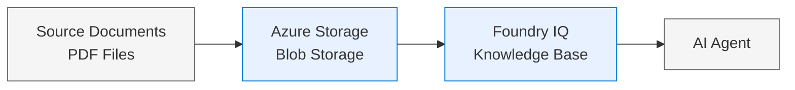
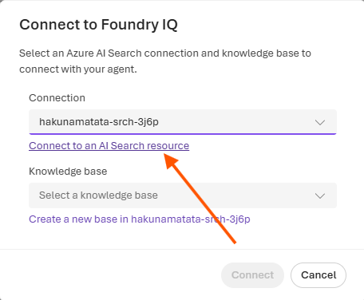
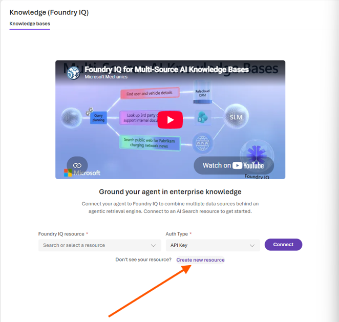
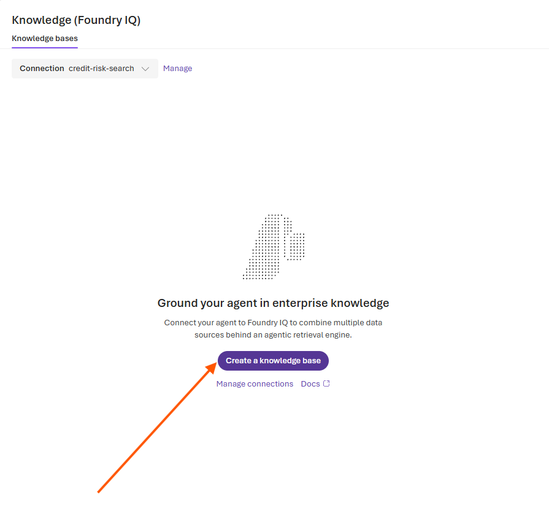
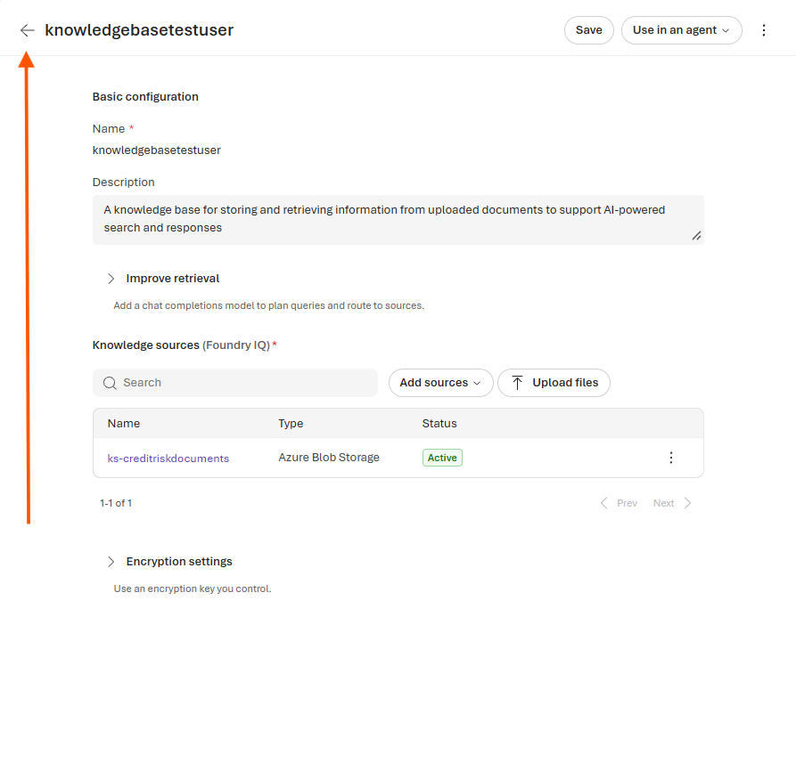
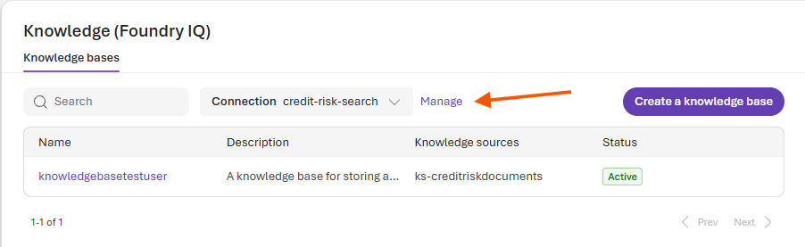
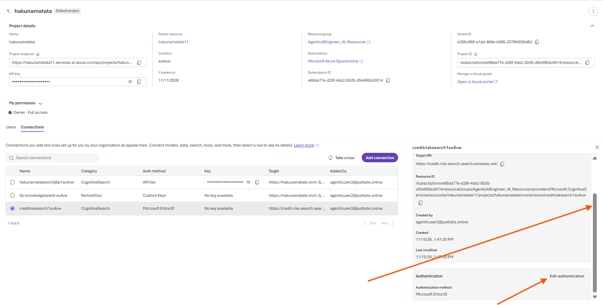

---
lab:
    title: 'Integrate an AI agent with Foundry IQ'
    description: 'Use Azure AI Agent Service to develop an agent that uses Foundry IQ to search knowledge bases.'
    level: 300
    duration: 45
    islab: true
    status: 'released'
---

# Integrate an AI agent with Foundry IQ

In this exercise, you'll configure an AI agent that uses Foundry IQ to search and retrieve information from a knowledge base. You'll use your existing Foundry project and deployed models, create a search resource and knowledge base with credit-risk assessment data, configure an agent, and then connect to it from Visual Studio Code.

This exercise should take approximately **45** minutes to complete.

## Prerequisites

Before starting this exercise, ensure you have:

- An [Azure subscription](https://azure.microsoft.com/free/)
- [Visual Studio Code](https://code.visualstudio.com/) installed on your local machine
- [Python 3.12](https://www.python.org/downloads/) or later installed
- An existing Foundry project with deployed chat and embedding models
- Basic familiarity with the Microsoft Foundry portal and Python programming

## Introduction to Foundry IQ

In the previous labs, you worked with data that was either stored locally in the project, loaded through application code, or provided directly to the model.

In this lab, we introduce **Foundry IQ**, which provides a knowledge layer that allows an AI agent to search and retrieve information from connected data sources when answering questions.

> [!IMPORTANT]
> The credit-risk documents required for this lab are available in the [`lab03-integrate-agent-with-foundry-iq/data`](https://github.com/Kiran-255666/AgenticAIEngineer/tree/main/labfiles/Day06/lab03-integrate-agent-with-foundry-iq/data) folder.
> These files are provided so you can **refer to the source documents and understand the data being used**. They are not loaded or read directly by the Python application. Instead, the documents are stored in an Azure data source and connected to the agent through **Foundry IQ**.



This means the agent can search the connected knowledge source and retrieve relevant information when you ask a question, rather than requiring the documents to be included directly in the application code or model prompt.

## Create an agent

1. In a web browser, open the [Foundry portal](https://ai.azure.com) and sign in using your Azure credentials if you haven't / logout.

1. Select your existing Foundry project.

1. Click **Home**, then click **Create an agent**.

2. Create an agent with a descriptive name, such as `cra-<unique_suffix>`, and set the **Interaction mode** to **Text**.

3. Select **Create**.

4. After the agent is created, the agent playground opens

5. Give your agent the following instructions to make it a **credit-risk assessment agent**:

    ```
    You are a helpful AI assistant for credit-risk assessment.
    You must ALWAYS search the knowledge base to answer questions about the company documents,
    financial information, credit bureau information, and credit-risk assessment rules.
    Provide detailed, accurate information and always cite your sources.
    If you don't find relevant information in the knowledge base, say so clearly.
    ```
    
6. Select **Save** to save your current agent configuration.

7. You'll now use configured the agent with credit-risk assessment information from Foundry IQ.

<details>
<summary>View the resource creation and Foundry IQ configuration setup steps from scratch</summary>

## Configure Foundry IQ

> **Note:** 
> The Azure AI Search, Storage Account, and Foundry IQ resources required for this lab have already been provisioned. This section is provided to help you understand the resource creation process and Foundry IQ configuration from scratch. Review the steps to understand the setup process, then skip to [Configure the playground](#configure-the-playground) to continue with the lab.
    
1. In the **Knowledge** section, expand the **Add** dropdown and select **Connect to Foundry IQ**.
1. In the Foundry IQ setup window, select **Connect to an AI Search resource**, then select **Create new resource**.

    
    
    

1. Create a search resource with the following settings:

   - **Resource name**: Replace the default populated name with an appropriate, descriptive name. Ideally, use `credit-risk-search` for this lab to make the resource easy to identify, manage, and maintain.
   - **Subscription**: Keep the default selected subscription.
   - **Resource group**: Keep the default populated resource group.
   - **Region**: Keep the default populated region. If the quota is exhausted, change the region to **Central US**.
   - **Pricing tier**: Change to **Basic**.
   - Select the checkbox acknowledging that agentic retrieval usage beyond the free monthly allowance will incur additional costs, billed through Azure AI Search.
   - If prompted about **Foundry IQ Knowledge Base capabilities**, pause and continue next month.

1. Open the prepared credit-risk assessment files from `labfiles\Day06\lab03-integrate-agent-with-foundry-iq\data`.

    The folder contains the following files:

    ```
    company_documents.md
    financial_data.md
    credit_bureau_report.md
    credit_risk_assessment_rules.md
    ```

1. Open the [Azure portal](https://portal.azure.com). In the top search bar, search for **Storage accounts** and select **Storage accounts**.

1. Click **+ Create** to create a storage account with the following settings:

- **Subscription**: Use the default subscription. 
- **Resource group**: Use the default resource group.
- **Storage account name**: Enter a unique, memorable name that you can easily identify and reuse throughout the lab. Ideally, use a consistent naming format such as `st<your_unique_prefix>`.
- **Region**: Use the default region. If that region is unavailable due to capacity constraints, select **Central US**.
- **Primary service**: Select **Azure Blob Storage or Azure Data Lake Storage**.
- **Primary workload**: Leave the default selection unchanged and proceed to the next step.
- **Performance**: Select **Standard**.
- **Redundancy**: Select **Locally-redundant storage (LRS)**.

1. Click **Review and Create**, then **Create** again.

1. After the storage account is created, you can see a **notification** there
click **Go to Resource** to open it.

1. Select **Upload** from the top bar.

1. In the **Upload blob** pane, select **Create new**.

1. Name it `creditriskdocuments`.

1. Leave the **Anonymous access level** as **Private**.

1. Click **OK**.

1. Click **Browse for files** so we can browse to the prepared credit-risk assessment files, select all four **.md's**, and select **Upload**.

> **Tip:** Did you miss the path to the `.md` files for uploading? You can find them here: `labfiles\Day06\lab03-integrate-agent-with-foundry-iq\data`

1. On the **Overview** page of your storage account, under **Essentials**, select the **Resource group** name (**AgenticAIEngineer_AI_Resources**). 

1. This will open the resource group, where you can find your **Azure AI Search service(s)** and click recently created `credit-risk-search` **Foundary IQ (Azure AI Search)**.

1. In the left pane, select **Security + networking** > **Keys**. For **API Access control**, select **Both** and confirm the selection by clicking **Yes**.

1. Return to the Foundry portal and refresh the page.

1. On the **Knowledge (Foundry IQ)** page, select **Create a knowledge base**.
    
    

1. You will be redirected to **Create a new knowledge base**. Under **Knowledge sources (Foundry IQ)**. Click **Add Source**, choose **Azure Blob Storage** as the knowledge source, and configure the following settings:

   * **Name**: `ks-creditriskdocuments`
   * **Description**: `Credit risk assessment documents`
   * **Storage account name**: Select the storage account you created earlier using the name `st<your_unique_prefix>`.
   * **Container name**: `creditriskdocuments`
   * **Authentication type**: API Key
   * **Content extraction mode**: minimal
   * **Embedding model**: Select your available deployed embedding model (`text-embeddings-ada-002`)
   * **Chat completions model**: Select your available deployed chat model (`gpt-5.2`)

   > **Note:** `gpt-5.4-mini` isn't available, so select `gpt-5.2` as the chat completions model.

1. Select **Create**. It will take 1-2 minutes to complete saving the knowledge base.

1. You will now be returned to the **Knowledge Base creation** page:

- **Name**:knowledgebase<your_unique_prefix>,
- **Description** : `A knowledge base for storing and retrieving information from uploaded documents to support AI-powered search and responses`
- **Chat completions model**: **gpt-5.4-mini** from the dropdown 
- **Remaining settings unchanged**.

1. Select **Save knowledge base**. Refresh the browser until the knowledge source status is **Active**.

1. Select the back button to return to the **Knowledge** page, then select **Manage** next to the **Connection** dropdown.

    
    

1. Scroll to **Connected resources**, select your search service.
1. After selecting your search service, a **details panel** will appear on the right. Scroll down in the panel to find the **Authentication** section.
1. Select **Key authentication**, then select **Edit authentication**.

    

1. You will be redirected to **Edit authentication**. Change **Auth Type** to **API** from the dropdown.

1. Return to the Azure portal. Under **Keys** > **Manage admin keys** > **Primary admin key**, copy the key and paste it into **API Key**.

1. Click **Save**. Now your **Foundry IQ knowledge base** is now connected to the **credit-risk assessment documents** and ready for use by your agent.

1. Navigate back to your agent from the project **Home** then select **Agents** from the side panel. Search the agent you created earlier, such as `cra-<unique_suffix>`.

</details>

## Configure the playground

1. Under **Tools**, select **Knowledge**, click **Add**, and then select **Connect to Foundry IQ**.

2. In the **Connect to Foundry IQ** pop-up, configure the following settings:

- **Connection**: Open the dropdown and select the connection associated with the `credit-risk-search` Azure AI Search resource.
- **Knowledge base**: Open the dropdown and select the Knowledge Base you created earlier. Ideally, it should be `knowledgebase<your_unique_prefix>`.

3. Select **Connect**.

4. Click Save

## Test the agent in the playground

1. Use the following expected responses to verify that the agent is successfully retrieving information from the Foundry IQ knowledge source.

#### Query 1

**Prompt**

```text
Retrieve information from the connected knowledge source and tell me what documents are available for Apex Manufacturing Pvt Ltd. List each available document and include the company name and registration status mentioned in the documents.
```

**Expected AI Response**

- Company Registration Certificate
  - Company Name: Apex Manufacturing Pvt Ltd
  - Registration Status: Active

- GST Registration Certificate
  - Company Name: Apex Manufacturing Pvt Ltd
  - Registration Status: Active

- Both required documents are available.
- Company names match across the provided documents.

---

#### Query 2

**Prompt**

```text
Retrieve the financial information for Apex Manufacturing Pvt Ltd for the financial year 2025 from the connected knowledge source. Include current assets, current liabilities, total debt, shareholders' equity, revenue, and net profit.
```

**Expected AI Response**

- Company Name: Apex Manufacturing Pvt Ltd
- Financial Year: 2025
- Current Assets: 7,800,000
- Current Liabilities: 5,000,000
- Total Debt: 9,300,000
- Shareholders' Equity: 5,000,000
- Revenue: 9,000,000
- Net Profit: 500,000

The agent should successfully retrieve the required financial information from the connected Foundry IQ knowledge source.

---

#### Query 3

**Prompt**

```text
Retrieve the external credit bureau information for Apex Manufacturing Pvt Ltd from the connected knowledge source. Tell me the external credit bureau score, industry, and credit bureau status, and mention whether any adverse records are reported.
```

**Expected AI Response**

- External Credit Bureau Score: 720
- Industry: Manufacturing
- Credit Bureau Status: No adverse records reported
- Adverse Records Reported: No

The agent should successfully retrieve the credit bureau information from the connected Foundry IQ knowledge source and return the credit score, industry classification, credit bureau status, and adverse record details.

1. In the agent details page, copy the following information to a notepad. You'll use these values when configuring the client application:

    - **Agent name**: The name you created, such as `cra-<unique_suffix>`
    - **Project endpoint**: Available from the project home page such as `https://hakunamatata11.services.ai.azure.com/api/projects/hakunamatata`

# Connect to your agent from an app

Now that the agent and knowledge base work in the portal, use the provided Python application to communicate with the agent programmatically.

# Get the application files from GitHub

1. If you have already downloaded and extracted the repository in a previous lab, delete the existing ZIP file and the extracted folder. This will allow us to use the PowerShell commands in the following steps and help avoid long path issues.

2. Open a web browser and go to the [lab files on GitHub](https://github.com/Kiran-255666/AgenticAIEngineer).

3. On the repository page, select the green **`<> Code`** button, and then select **Download ZIP**.

4. Once the download finishes, extract the ZIP file.

5. Open ****PowerShell**** and run the following two commands to avoid long path issues:

```powershell
Copy-Item "C:\Users\agenticuser\Downloads\AgenticAIEngineer-main\AgenticAIEngineer-main\labfiles\Day06\lab03-integrate-agent-with-foundry-iq" "$env:USERPROFILE\Desktop\lab03-integrate-agent-with-foundry-iq" -Recurse

code "$env:USERPROFILE\Desktop\lab03-integrate-agent-with-foundry-iq"
```

The first command copies the lab folder to your ****Desktop****, and the second command opens the copied folder directly in ****Visual Studio Code****.

This folder already contains the application files and the required code for this exercise.

6. You are now working from the ****Desktop**** folder, so there is no need to worry about the long path issue. Press ****Ctrl+Shift+`**** to open the integrated terminal.

7. In the terminal, enter the following commands to create and activate a virtual environment and install the required Python packages:

   ```
   python -m venv labenv
   .\labenv\Scripts\Activate.ps1
   pip install -r requirements.txt
   ```

8. Configure the environment variables
Open the **`.env`** file from the side panel and fill in the following:

    ```
    PROJECT_ENDPOINT=https://hakunamatata11.services.ai.azure.com/api/projects/hakunamatata
    AGENT_NAME=credit-risk-assessment-agent-<your_suffix>
    ```
    
Replace `<your_suffix>` with the unique suffix you used when creating the agent.

## Review the agent client code

The required client code has already been added to **`agent_client.py`**. Review the file before running the application.

The client connects to the existing Microsoft Foundry agent, creates a conversation, sends user questions to the agent, and displays the responses returned from the connected Foundry IQ knowledge source.

### Load the configuration

The application loads the project endpoint and agent name from the `.env` file:

```python
load_dotenv()

project_endpoint = os.getenv("PROJECT_ENDPOINT")
agent_name = os.getenv("AGENT_NAME")
```

The client checks that both values are available before connecting to the Foundry project.

### Connect to the Foundry project

The client uses `DefaultAzureCredential` to authenticate and `AIProjectClient` to connect to the existing Foundry project:

```python
credential = DefaultAzureCredential(
    exclude_environment_credential=True,
    exclude_managed_identity_credential=True
)

project_client = AIProjectClient(
    credential=credential,
    endpoint=project_endpoint
)
```

### Connect to the agent

The client retrieves the existing agent using the agent name configured in `.env`:

```python
agent = project_client.agents.get(
    agent_name=agent_name
)

print(f"Connected to: {agent.name}")
```

This allows the Python application to send questions to the agent that was configured with Foundry IQ.

### Create a conversation

The client creates a conversation for the current session:

```python
conversation = openai_client.conversations.create()
```

The same conversation is used for the questions entered during the session.

### `send_message_to_agent`

The `send_message_to_agent()` function sends the user's question to the connected Foundry agent:

```python
def send_message_to_agent(user_message):
    response = openai_client.responses.create(
        conversation=conversation.id,
        extra_body={
            "agent_reference": {
                "name": agent.name,
                "type": "agent_reference"
            }
        },
        input=user_message
    )

    print("\nAgent:")
    print(response.output_text)
```

The user's question is sent to the agent using the Responses API. The agent can use the connected Foundry IQ knowledge source to retrieve relevant information before generating its response.

The returned response is then displayed in the terminal.

### `main`

The `main()` function provides the command-line interface:

```python
def main():
    while True:
        try:
            user_input = input("\nYou: ").strip()

            if not user_input:
                continue

            if user_input.lower() in {"quit", "exit"}:
                print("\nConversation ended.")
                break

            send_message_to_agent(user_input)

        except KeyboardInterrupt:
            print("\n\nConversation ended.")
            break

        except Exception as e:
            print(f"\nError: {str(e)}")
```

You can continue asking questions during the same conversation.

To stop the application, enter **`quit`**, enter **`exit`**, or press **Ctrl+C**.

## Test the integration

1. In the integrated terminal, verify that you are signed in to Azure:

```powershell
az account show
```

> **Note:** If you encounter an authentication issue, run `az logout`, then `az login`, and run `az account show` again.

2. Run the client:

```powershell
python agent_client.py
```

3. You should see output similar to:

```text
Credit Risk Assessment Agent
----------------------------
Connected to: credit-risk-assessment-agent-uday
Ask questions about the credit-risk assessment.
Type 'quit' or 'exit' to stop.
```

4. Test the following queries.

### Test Case 1: Company documents

Enter:

```text
What documents are available for Apex Manufacturing Pvt Ltd?
```

The agent should retrieve information similar to:

```text
For Apex Manufacturing Pvt Ltd, the available documents are:

1. Company Registration Certificate
   Registration Number: U29299KA2018PTC112345
   Status: Active

2. GST Registration Certificate
   GSTIN: 29AABCA1234F1Z5
   Status: Active

3. Financial Information for Financial Year 2025

4. Credit Bureau Report
   External Credit Bureau Score: 720
   No adverse records reported

5. Credit Risk Assessment Rules
```

The response should include source citations when they are available.

### Test Case 2: Financial information

Enter:

```text
What financial information is available for Apex Manufacturing Pvt Ltd for 2025?
```

The agent should retrieve:

```text
Company Name: Apex Manufacturing Pvt Ltd
Financial Year: 2025

Current Assets: 7,800,000
Current Liabilities: 5,000,000
Total Debt: 9,300,000
Shareholders' Equity: 5,000,000
Revenue: 9,000,000
Net Profit: 500,000
```

### Test Case 3: Financial ratios

Enter:

```text
What are the current ratio, debt-to-equity ratio, and net profit margin for Apex Manufacturing Pvt Ltd?
```

The agent should calculate:

```text
Current Ratio:
7,800,000 / 5,000,000 = 1.56

Debt-to-Equity Ratio:
9,300,000 / 5,000,000 = 1.86

Net Profit Margin:
(500,000 / 9,000,000) × 100 = 5.56%
```

The response should reference the financial information and assessment rules used for the calculations.

### Test Case 4: Credit bureau information

Enter:

```text
What is the external credit bureau score and industry for Apex Manufacturing Pvt Ltd?
```

The agent should retrieve:

```text
External Credit Bureau Score: 720
Industry: Manufacturing
Credit Bureau Status: No adverse records reported
```

### Test Case 5: Credit-risk assessment rules

Enter:

```text
What credit-risk assessment rules should be used for Apex Manufacturing Pvt Ltd?
```

The agent should retrieve information about:

```text
Document Verification
Compliance
Financial Analysis
External Credit Bureau
Industry Risk
Scorecard
Final Risk Classification
Credit Recommendation
```

For Apex Manufacturing Pvt Ltd, the agent should identify **Manufacturing** as a **Medium Risk** industry according to the connected assessment rules.

### Review the results

When testing the agent, verify that:

* The agent retrieves information from the connected Foundry IQ knowledge source.
* Company, financial, and credit bureau information matches the provided documents.
* Financial ratios are calculated using the assessment rules.
* The agent can retrieve the credit-risk assessment rules.
* Source citations are displayed when available.
* Multiple questions can be asked within the same conversation.
* The agent does not invent information that is not available in the connected knowledge source.

> **Note:** The exact wording and formatting may differ because the response is generated by the AI agent. Focus on whether the retrieved information is accurate and grounded in the connected knowledge source.

## End the session

When you are finished testing, enter:

```text
quit
```

or:

```text
exit
```

You can also press **Ctrl+C** to stop the application.

To start a new session later, run:

```powershell
python agent_client.py
```

## Summary

In this exercise, you connected a Python client to an existing Microsoft Foundry agent configured with Foundry IQ.

You reviewed the client code, created a conversation, sent questions about Apex Manufacturing Pvt Ltd, and verified that the agent could retrieve company documents, financial information, credit bureau information, and assessment rules from the connected knowledge source.

The key takeaway is that the Python client provides a simple interface for interacting with a **Foundry IQ-enabled agent** and retrieving grounded information from the connected knowledge source.
