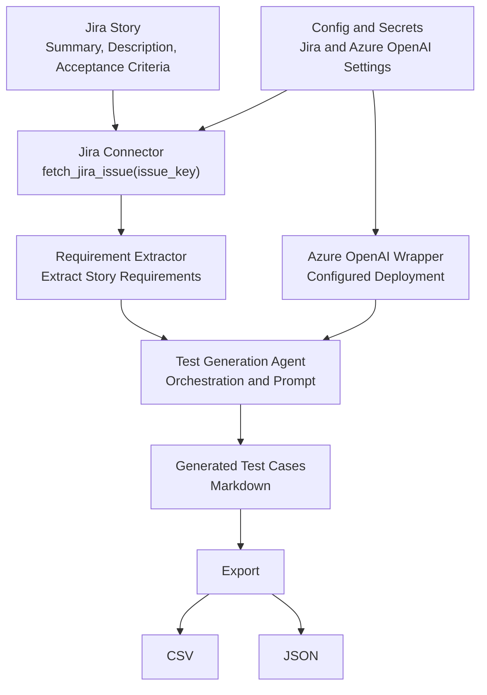
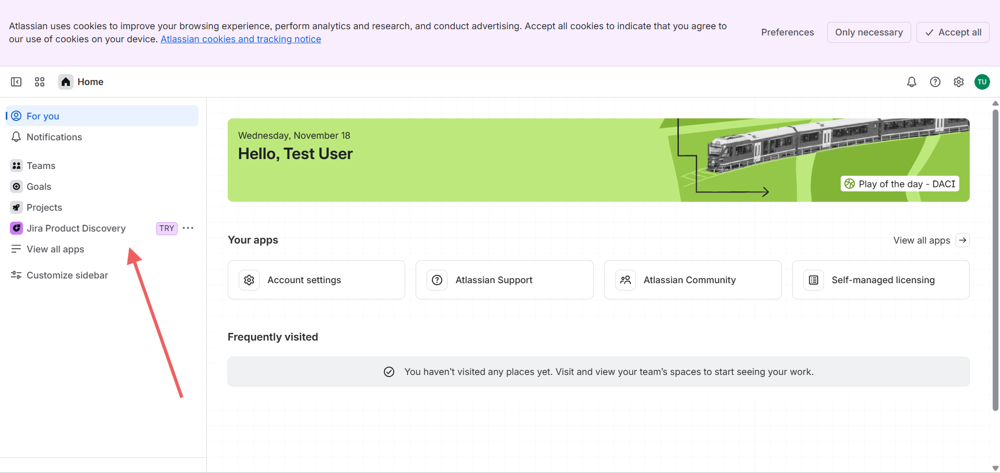
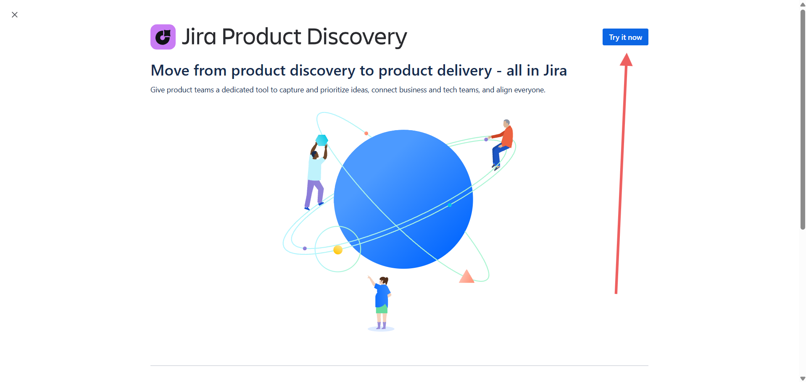
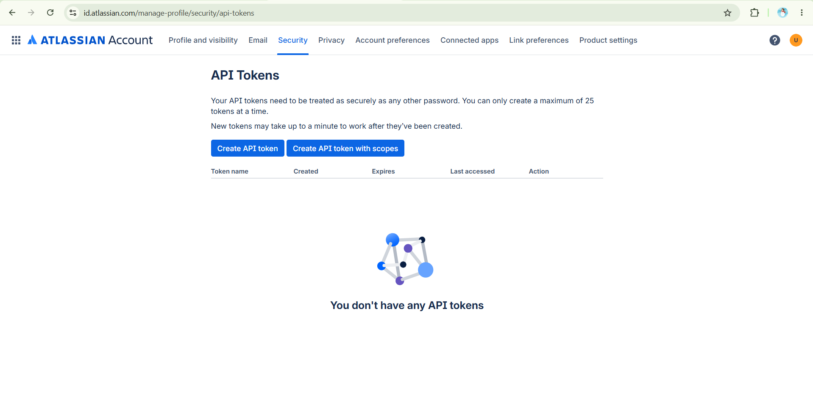
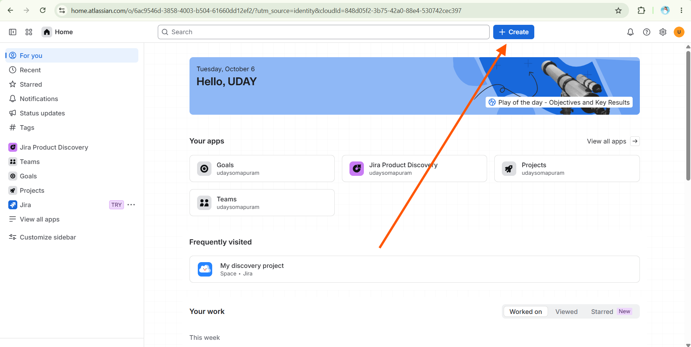

---
lab:
  title: Generate Credit Risk Test Cases from Jira Stories using Azure OpenAI
  description: Learn how to retrieve a Jira Story, extract its requirements, and use Azure OpenAI to generate structured test cases.
  level: 200
  duration: 60
  islab: true
  status: 'released'
---

# Generate Credit Risk Test Cases from Jira Stories using Azure OpenAI

## Overview

In this lab, you will build an AI-powered test generation agent that retrieves a user story from Jira, extracts its requirements, and generates structured software test cases using Azure OpenAI.

You will first create a Jira Cloud account using your personal Gmail or Microsoft Outlook email. Next, you will create a Jira workspace, generate an API token, and create a Story containing the credit-risk assessment requirements provided in this lab.

After creating the Story, you will download the provided Jupyter notebook, configure your Jira credentials and the Azure OpenAI settings provided for the lab, and execute the notebook.

The generated test cases will cover positive, negative, and edge scenarios and can be exported to Markdown, CSV, and JSON formats.

## Learning Objectives

By the end of this lab, you will be able to:

- Understand Jira projects, issues, Stories, and acceptance criteria.
- Create a Jira Cloud workspace and generate an API token.
- Create a Jira Story containing structured business requirements.
- Connect to Jira using its REST API.
- Extract requirements from a Jira issue.
- Use Azure OpenAI to generate structured test cases.
- Export generated test cases into CSV and JSON formats.

## 1. Architecture Overview

### High-level flow

The solution consists of six components:

1. **Config and Secrets:** Configure the Jira URL, user email, API token, and Azure OpenAI settings. Keep credentials outside the source code whenever possible.
2. **Jira Connector (Tool):** A Python function named `fetch_jira_issue(issue_key)` calls the Jira REST API to retrieve the requested Story.
3. **Requirement Extractor:** Extracts the Story summary, description, and acceptance criteria from the Jira issue JSON.
4. **Azure OpenAI Wrapper:** Sends the extracted requirements to the configured Azure OpenAI deployment.
5. **Test Generation Agent:** Orchestrates the workflow by fetching the Story, extracting requirements, constructing a prompt, calling Azure OpenAI, and returning generated test cases in Markdown.
6. **Export:** Converts the generated Markdown test-case table into CSV and JSON formats.

### Architecture diagram



### Sample business workflow

The sample business workflow used in this lab is **Automate Credit Risk Assessment for New Corporate Customers**.

It describes a system that verifies submitted company documents, performs company and sanctions checks, validates financial information, calculates financial risk measures, retrieves external credit data, evaluates industry risk, and recommends appropriate credit terms.

The Jira Story contains the functional requirements, non-functional requirements, and acceptance criteria for this workflow. The AI agent uses the Story as its source when generating test cases.

**Important requirement-handling rules:**

- Preserve all explicitly documented business rules, formulas, score weights, thresholds, and classification boundaries.
- Do not invent missing business rules or fill gaps with assumptions.
- The 20-point Compliance component does not have a detailed point allocation in the Story. Treat its allocation as unspecified or configurable.
- The Story requires credit-limit and payment-term recommendations but does not define their exact mapping to risk categories. Do not invent these mappings.
- Generate test cases for defined requirements. Where a requirement depends on missing rules, identify the missing information instead of presenting an assumed result as expected behavior.

## 2. Understanding Jira and Story Details

Before creating the Story, understand the following Jira concepts.

| Concept | Description |
|---|---|
| Jira | Atlassian's project management and issue-tracking tool used to manage software development work. |
| Project | A workspace that organizes related issues, requirements, and development activities. |
| Issue | An individual work item in Jira, classified as a Story, Task, Bug, or Epic. |
| Epic | Groups related work into a larger initiative. |
| Story | Defines a user requirement from the perspective of someone who needs the functionality. |
| Task | Defines a specific piece of work to be completed. |
| Bug | Records a defect or unexpected software behavior. |
| Summary | Provides the title of the issue. |
| Description | Explains the issue's purpose, business context, and requirements. |
| User Story | Defines who needs what functionality and why. |
| Business Context | Explains the business problem or objective being addressed. |
| Functional Requirements | Define what the system must do. |
| Non-Functional Requirements | Define performance, security, reliability, and other quality expectations. |
| Acceptance Criteria | Define testable conditions that determine whether a requirement is satisfied. |

### Understanding Given–When–Then acceptance criteria

Acceptance criteria are often written using the Given–When–Then format:

- **Given:** Describes the initial condition or precondition.
- **When:** Describes the action or event.
- **Then:** Describes the expected outcome.

For example:

- Given a new corporate customer assessment is started.
- When valid Company Registration and GST Certificates are uploaded.
- Then the assessment may proceed to the next validation step.

These conditions help the test generation agent identify scenarios and expected results.

## 3. Story Details

You will create a Jira Story using the following sample business requirements.

### 3.1 Summary

Use the following text in the Jira **Summary** field:

```text
Automate Credit Risk Assessment for New Corporate Customers
```

### 3.2 Description

Copy the complete content below into the Jira **Description** field.

```markdown
## Story details

**Summary**

Automate Credit Risk Assessment for New Corporate Customers

**Issue Type**

Story

**Description**

**User Story**

As a credit analyst, I want the system to assess the credit risk of a new corporate customer using registration documents, financial information, external risk data, and industry risk so that I can assign an appropriate risk category, credit limit, and payment terms.

**Business Context**

Credit analysts currently review corporate customer documents and financial information manually. This process is time-consuming, inconsistent, and difficult to audit. An automated assessment workflow will validate required evidence, identify compliance concerns, calculate transparent financial measures, combine internal and external risk signals, and provide a consistent recommendation for review.

---

### Functional Requirements

1. **Document Verification**
   - Verify that a Company Registration Certificate has been uploaded.
   - Verify that a GST Certificate has been uploaded.
   - Reject or flag the assessment when a required document is missing, unreadable, or invalid.

2. **Company and Compliance Checks**
   - Match the company name across the registration certificate, GST certificate, and customer record.
   - Verify the company's MCA status.
   - Perform sanctions screening and flag a potential match for analyst review.

3. **Financial Validation and Ratios**
   - Validate that two years of financial statements have been provided and are readable.
   - Calculate Current Ratio as current assets divided by current liabilities.
   - Calculate Debt-to-Equity Ratio as total debt divided by shareholders' equity.
   - Calculate Net Profit Margin as net profit divided by revenue.
   - Do not calculate a ratio when its denominator is zero or the financial input is invalid.

4. **Credit Risk Scorecard**
   - Calculate a final score out of 100 using these component weights:
     - Compliance: 20 points
     - Liquidity: 20 points
     - Leverage: 15 points
     - Profitability: 15 points
     - External Credit Bureau: 15 points
     - Industry Risk: 15 points
   - Use the following Current Ratio scoring thresholds for Liquidity:
     - Current Ratio >= 1.5: 20 points
     - Current Ratio 1.2-1.49: 15 points
     - Current Ratio 1.0-1.19: 8 points
     - Current Ratio < 1.0: 0 points
   - Use the following Debt-to-Equity scoring thresholds for Leverage:
     - Debt-to-Equity <= 0.5: 15 points
     - Debt-to-Equity 0.51-1.0: 12 points
     - Debt-to-Equity 1.01-2.0: 6 points
     - Debt-to-Equity > 2.0: 0 points
   - Use the following Net Profit Margin scoring thresholds for Profitability:
     - Net Profit Margin >= 15%: 15 points
     - Net Profit Margin 10%-14.99%: 12 points
     - Net Profit Margin 5%-9.99%: 6 points
     - Net Profit Margin < 5%: 0 points
   - Assign External Credit Bureau points from the D&B score:
     - D&B score >= 700: 15 points
     - D&B score 650-699: 10 points
     - D&B score 600-649: 5 points
     - D&B score < 600: 0 points
   - Assign Industry Risk points from this matrix:
     - Low Risk, 15 points: Utilities, Government, Healthcare
     - Medium Risk, 10 points: Manufacturing, FMCG Distribution, IT Services
     - High Risk, 0 points: Construction, Real Estate Developers, Airlines, Commodity Trading, Startups, Mining and Metal
   - Assign Compliance points according to the configured compliance policy when required documents, company-name matching, MCA status, and sanctions screening pass.

5. **Risk Classification Rules**
   - Score > 80: Low Risk
   - Score 50-80, inclusive: Medium Risk
   - Score < 50: High Risk
   - Apply the boundaries exactly as written, including scores of 50 and 80.

6. **Assessment and Recommendation**
   - Retrieve the customer's D&B score.
   - Determine the Industry Risk Rating using the industry risk matrix.
   - Calculate the final credit risk score from the configured document, compliance, financial, external, and industry inputs.
   - Assign a risk category based on the final score.
   - Recommend a credit limit and payment terms based on the risk category and assessment rules.
   - Store the assessment inputs, calculations, result, and recommendation for audit purposes.

---

### Non-Functional Requirements

1. A complete assessment must produce a result within 10 seconds when all required services respond normally.
2. The assessment must be deterministic and use the documented scorecard, calculation, threshold, and risk-category rules.
3. Sensitive customer and financial data must be protected in transit and at rest, and must not be written to application logs.
4. The workflow must provide clear validation errors and support analyst review for compliance or data-quality exceptions.
5. The assessment result and supporting calculations must be traceable for audit purposes.

---

### Acceptance Criteria

1. **Required Documents**
   - Given a new corporate customer assessment is started
   - When the Company Registration Certificate and GST Certificate are uploaded and valid
   - Then the assessment may continue to the next validation step.
   - When either required certificate is missing, unreadable, or invalid
   - Then the assessment must be flagged and must not produce a final recommendation.

2. **Company Name and MCA Validation**
   - Given valid registration and GST certificates
   - When the company names match and the MCA status is active
   - Then the company validation must pass.
   - When the names do not match or the MCA status is not active
   - Then the assessment must be flagged for review.

3. **Sanctions Screening**
   - Given a corporate customer is being assessed
   - When sanctions screening returns no potential match
   - Then the compliance check must pass.
   - When screening returns a potential match
   - Then the assessment must be flagged for analyst review and must not automatically approve credit terms.

4. **Financial Statements and Ratio Thresholds**
   - Given two years of valid financial statements
   - When the statements are processed
   - Then the system must calculate Current Ratio, Debt-to-Equity Ratio, and Net Profit Margin using the configured formulas.
   - Then the system must award Liquidity, Leverage, and Profitability points using the documented thresholds.
   - When statements are missing, unreadable, or contain invalid or zero denominators
   - Then the assessment must report a validation error and must not calculate an invalid ratio.

5. **Scorecard Component Boundaries**
   - Given valid assessment inputs
   - When a D&B score is 700, 650, 600, or just below one of those boundaries
   - Then the system must award 15, 10, 5, or 0 points according to the D&B thresholds.
   - When the customer belongs to an industry in the Low, Medium, or High matrix
   - Then the system must award the corresponding Industry Risk points.
   - The final score must equal the sum of Compliance, Liquidity, Leverage, Profitability, External Credit Bureau, and Industry Risk points, with a maximum of 100.

6. **Risk Classification and Recommendation**
   - Given a final score above 80, between 50 and 80 inclusive, or below 50
   - Then the system must assign Low Risk, Medium Risk, or High Risk respectively.
   - And it must recommend a credit limit and payment terms consistent with that category.
   - The assessment must retain the inputs, calculations, final score, category, and recommendation for audit.

7. **Response Time and Data Protection**
   - Given normal responses from dependencies
   - When a complete assessment is submitted
   - Then the result must be returned within 10 seconds.
   - Sensitive document contents and financial values must not appear in application logs.
```

**Note:** The Story does not specify the detailed allocation of the 20 Compliance points or the exact credit-limit and payment-term mappings. These must remain unspecified unless a separate business policy provides them. Do not add assumed values when generating test cases.

## 4. Jira Configuration

> [!TIP]
> Keep Notepad open while completing these steps. Copy and save your Jira workspace URL, registered email address, generated API token, and newly created Story key. You will need these values in the next section when configuring and running the lab notebook. Keep your API token private and do not share it.

Before running the notebook, create a Jira Cloud account, create a Jira workspace, generate an API token, and create the Story containing the credit-risk requirements.

### 4.1 Create a Jira Cloud Account

1. Open [Atlassian account signup](https://id.atlassian.com/signup).
2. Locate the **Email** field and enter your personal Gmail address, then select **Sign up**. Alternatively, you can continue using Google, Microsoft, Apple, or Slack. 
> **TIP** Ideally use fill your personal Gmail address in Email field.
3. Complete the verification using the code sent to your registered email address.
4. Enter your Full Name, set a strong alphanumeric password, and continue.
5. From the Atlassian navigation, open Jira Product Discovery.



6. Select **Try it now**.



7. When asked for a workspace name, enter a unique name and click **Next**
8. Wait for the workspace setup to complete. This may take a few minutes.

Your Jira workspace URL will look similar to:

```text
https://<your-unique-name>.atlassian.net
```

Copy the workspace URL. Remove any additional page path after `.net`.

This is the value you will use for `JIRA_BASE_URL`.

> [!TIP] 
> Save this in NOTEPAD!

### 4.2 Create a Jira API Token

1. Open the [Atlassian API token page](https://id.atlassian.com/manage-profile/security/api-tokens).
2. Complete the verification code sent to your Atlassian account email if prompted.



3. Select **Create API token**.
4. Enter a descriptive name for the token.
5. Set an expiration date according to your requirements.
6. Select **Create**.
7. Copy the generated API token and keep it secure.

**Important:** The API token is displayed when it is created. Store it securely because it must not be committed to source control or shared with others.

### 4.3 Create a Jira Story

1. Open [Atlassian Home](https://home.atlassian.com/).
2. Open your Jira workspace.
3. From the Jira navigation, select **Create**.



4. Leave the Space or Project field at its default value, as applicable.
5. In **Summary**, copy the text from [3.1 Summary](#31-summary).
6. In **Description**, copy the complete content from [3.2 Description](#32-description).
7. Select **Create**.

After the Story is created, Jira displays a confirmation containing the newly created issue key.

For example:

```text
You've created "MDP-x" idea
```

The key, such as `MDP-x`, is the `ISSUE_KEY` required by the notebook.

Copy the Story key. You will use it in the notebook configuration.


### 4.4 Configure Jira Values

The notebook reads Jira configuration from environment variables or accepts values interactively. This avoids hard-coding credentials in the notebook.

| Variable | Description | Example |
|---|---|---|
| `JIRA_BASE_URL` | Jira Cloud workspace URL | `https://<your-unique-name>.atlassian.net` |
| `JIRA_EMAIL` | Email address associated with the Jira account | `user@example.com` |
| `JIRA_API_TOKEN` | API token generated from the Atlassian account | Your generated API token |
| `ISSUE_KEY` | Key of the Jira Story containing the requirements | `MDP-x` |

You can set these values in your shell before starting Jupyter, or enter them interactively when prompted by the notebook.

Interactive values are kept in memory and are not written to a file.

**Security:** Never commit your Jira API token or other credentials to source control.

### 4.5 Verify the Configuration

Before running the Jira connector, verify that:

- `JIRA_BASE_URL` contains only the Jira workspace URL and does not include `/jira/...` or another page path.
- `JIRA_EMAIL` matches the email address associated with your Jira account.
- `JIRA_API_TOKEN` contains the API token you generated.
- `ISSUE_KEY` contains the key of the Story you created, such as `MDP-x`.

## 5. Download and Run the Lab Notebook

1. Open the [Jira and Azure OpenAI Test Generation Notebook](https://github.com/Kiran-255666/ai-agentic-engineer-msfoundry/blob/main/labfiles/Day08/lab02-jira-openai-test-generation.ipynb).
2. Click **Download raw file** to download the `.ipynb` notebook.
3. Open the downloaded notebook in Jupyter Notebook or JupyterLab.
4. Configure the required Jira credentials, Story key, and Azure OpenAI details.
5. Execute the notebook cells in order and continue until all cells have completed successfully.

**Tip:** You can download the notebook directly using the **Raw** option on GitHub.
