---
lab:
  title: Create agents with Copilot Studio
  module: Create agents in Microsoft Copilot Studio
  description: In this exercise, you will access the Microsoft Copilot Studio portal, select the appropriate environment, and create a new agent.
  duration: 55 minutes
  level: 200
  islab: true
  primarytopics:
    - Microsoft Copilot
    - Microsoft Copilot Studio
---

# Create agents with Copilot Studio

## Scenario

In this exercise, you will:

- Create an agent from a template
- Create and name an agent
- Define how the agent should behave using instructions
- Add a public website as a knowledge source
- Publish the agent and test with the Demo website

This exercise will take approximately **45** minutes to complete.

## What you will learn

- How to create an agent from a template
- How to create an agent using natural language
- How agent instructions influence generative behavior
- How Generative AI answers use configured knowledge sources
- How to publish an agent to the Demo website

## High-level lab steps

- Create an agent from a template
- Create an agent using Copilot
- Define agent behavior using instructions
- Add Generative AI knowledge sources
- Publish the agent

## Prerequisites

- Have a Microsoft Entra ID account
- Have a Copilot Studio license or have signed up for a free trial.
- Have access to a Power Platform environment and a solution where you can create agents and related assets.
- You can use:
  - the environment and **Lab Exercises** solution created in the **ILT Setup** lab, or
  - your own existing environment and solution.
- If you do not already have an environment and solution prepared, complete the steps in the **ILT Setup** lab before continuing.

## Key concept: Agent components and behavior

When generative orchestration is enabled, the agent can use instructions, knowledge, topics, and tools to generate responses dynamically.

## Exercise 1 - Create an agent from a template

In this exercise, you will create an agent by using a template, and then test the agent.

### Task 1.1 – Create an agent from the Safe Travels template

Open the **Copilot Studio** home page: `https://copilotstudio.microsoft.com/`

> [!IMPORTANT]
> You might notice a new Copilot Studio experience. Some features used in these labs are not available in the new experience, so for these labs use the **Classic Experience**.
>
> The image below shows the **Classic Experience** UI. If your interface looks like this, you're good to go. Continue to the next section. If it looks different, expand the section below and switch back to the **Classic Experience**.
>
> 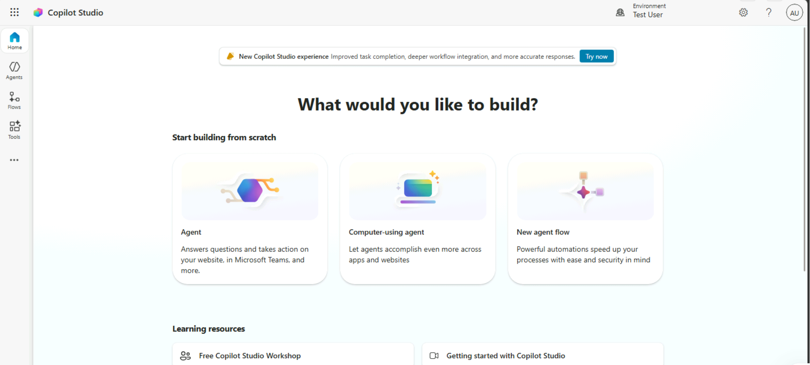
>
> <details>
> <summary>Does your interface look different? Click here</summary>
>
> 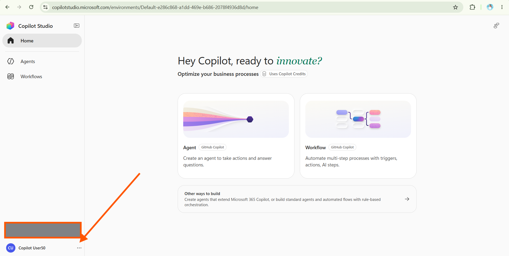
>
> Select **...** (More options) at the bottom of the page. Under **Explore**, select **Open Classic Experience** to switch back to the **Classic Experience**.
>
> </details>

1. In the **upper-right corner** of the page, verify that the **environment you created for this exercise** is selected. If the correct environment is not selected, follow **`Task 1.3 - Access Copilot Studio`** in **`Lab-00-ILT-setup.md`**.

1. Select **Agents** in the left-hand navigation.

1. Under **Start with an agent template** section, select the **Safe Travels** template.

   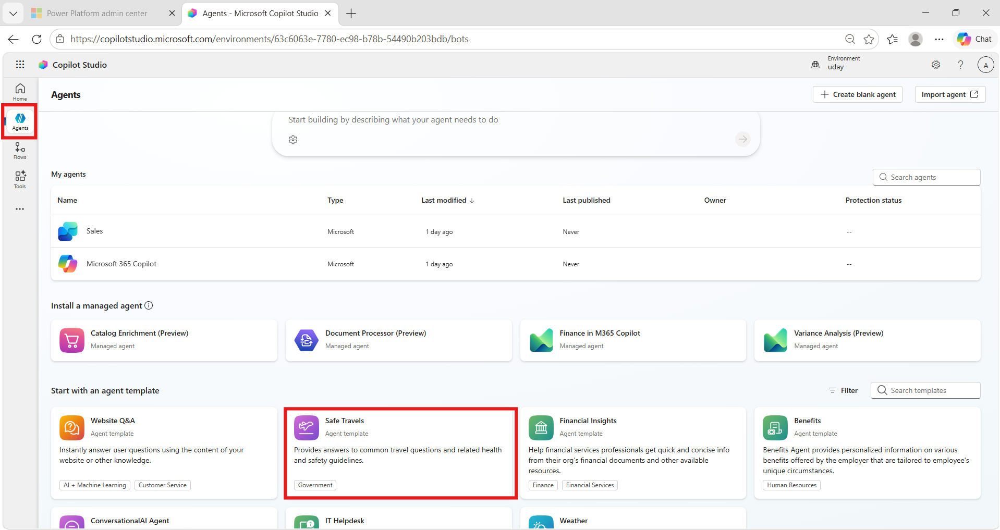

1. In the upper-right of the page, select the ellipses (**...**) and select **Edit advanced settings**.

1. If Solution is already set to **Lab Exercises** and the Schema name already uses the **fab** prefix, select **Cancel**. Otherwise, set **Solution** to **Lab Exercises**, update the **Schema name** to use the **fab prefix**, and select **Save**.

1. In the upper-right of the page, select **Create**.

1. In the **Overview** tab, review the name, description, and agent instructions.

1. Select the **Knowledge** tab and review the public website that has been added as a knowledge source.

1. In the upper-right of the page, select the **Settings** button.

   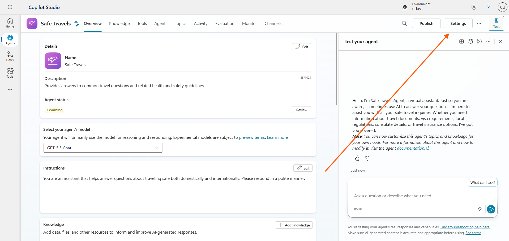

1. Verify that **Orchestration** is set to **No - Use classic orchestration, limiting responses to the content and behavior defined in your agent's topics**.

1. In the upper-right of the Settings page, select **X** icon to close settings.

1. Select the **Topics** tab and select the **System** filter.

   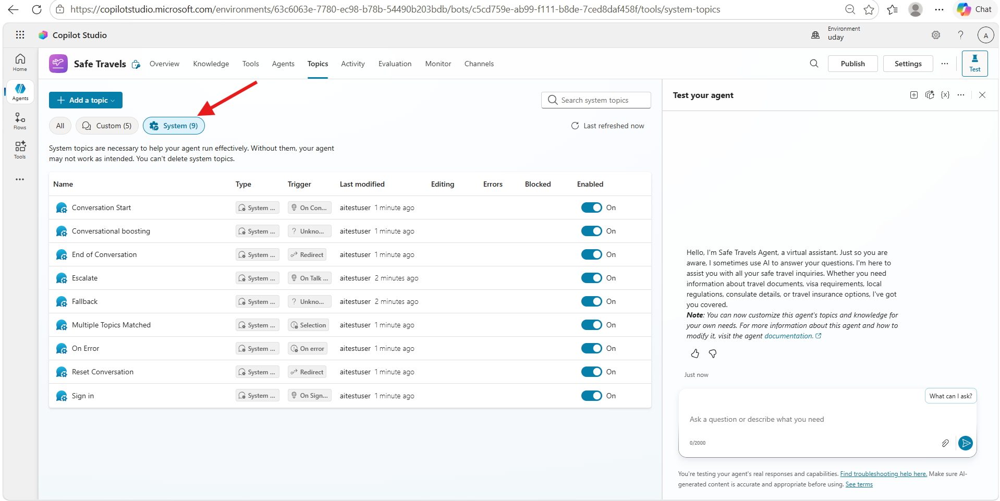

1. Select the **Conversational Start** topic. Review the contents of the **Message** node. The message is displayed in the **Test** pane. The message content may vary slightly. The snippet below is provided for reference.
   
   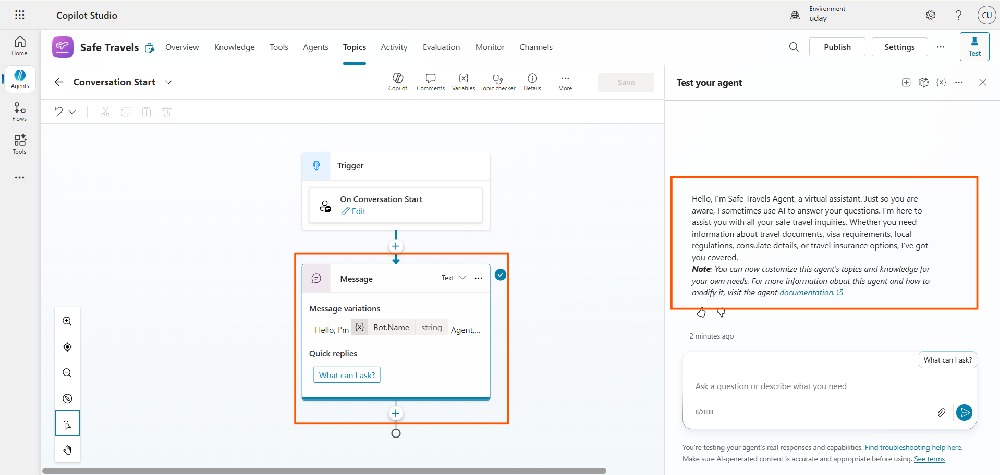

1. In the drop-down in the upper-left of the page that is showing Conversation Start, select the custom **What can I ask** topic.
   
   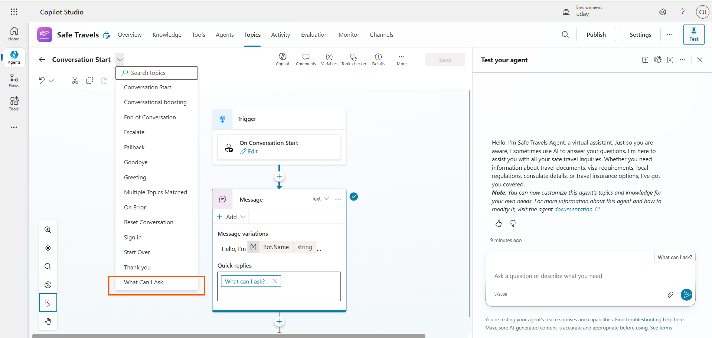 

### Task 1.2 – Test the agent

1. If the **Test** pane is not visible, select the **Test** icon in the upper-right of the page.

1. In the **Test** pane, select the ellipses (**...**) next to the **{x}** icon, then turn **Track between topics** **On**.

   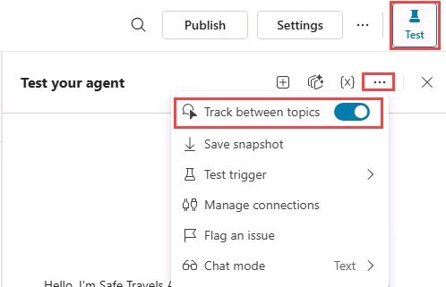

1. Enter the following prompt:

   ```prompt
   Hello
   ```

   The agent will use the default **Greeting** topic and respond with a greeting, typically asking how it can help you. The exact response may vary.

1. At the top of the **Test** pane, select the **Start new test session** icon **+**.

   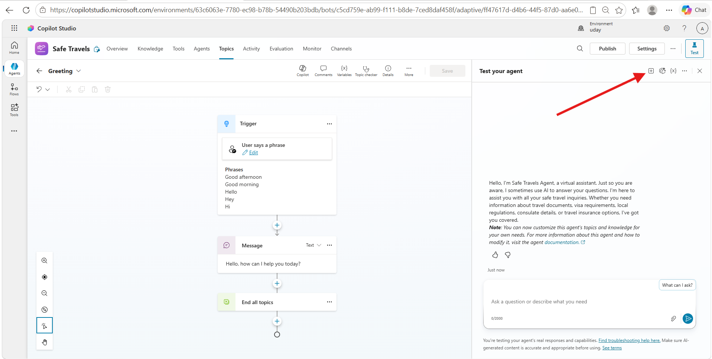

1. Enter the following prompt:

   ```prompt
   What can I ask?
   ```

   The **What Can I Ask** topic will be triggered and present several prompt options to continue the conversation.

1. Select the **How do I get a passport?** option.

   The response may vary slightly from the example shown below. It is generated using the configured knowledge source and may reference the **Conversational boosting** system topic.

   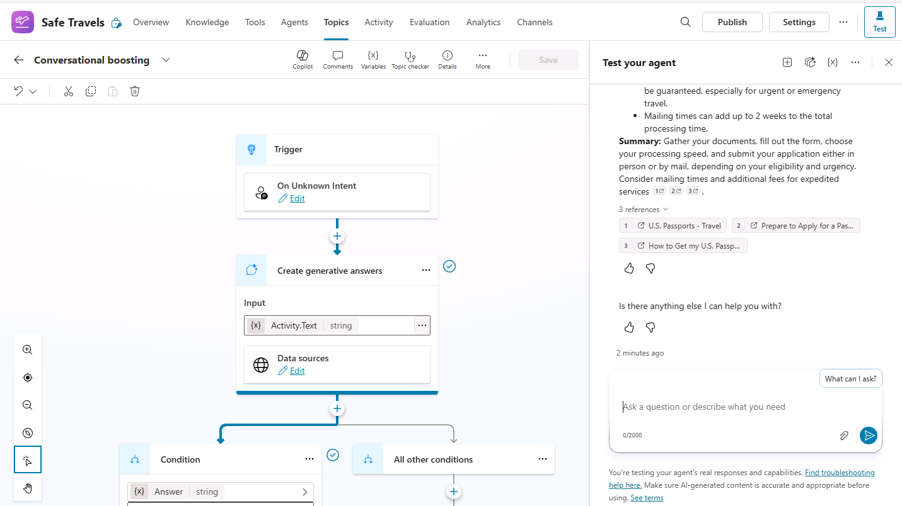

1. Enter the following prompt:

   ```prompt
   What is Copilot Studio?
   ```

   The **Fallback** topic should be selected, and agent should ask you to try rephrasing.

1. Repeat the same prompt two more times. Depending on your environment and orchestration behavior, the agent may trigger the **Fallback** or **Escalate** system topics. You may see a response similar to: **I'm sorry, I'm not sure how to help with that. Can you try rephrasing?**

1. Select **Agents** in the left-hand navigation. The **Safe Travels** agent should be listed.

## Exercise 2 - Create an agent using Copilot

In this exercise, you will create a new agent using natural language to answer questions about government benefits.

### Task 2.1 – Create an agent to answer questions about government benefits

1. In the **Copilot Studio** home page `https://copilotstudio.microsoft.com/`, Verify that you are working in the environment you created earlier and that you are using the **Classic Experience** UI.

1. Select **Agents** in the left-hand navigation.

1. Select **+ Create blank agent**

1. Enter **US Benefits Assistant** as the agent name, then click the **Optional** section.

1. Leave **English (United States)** set as the primary language for the agent.

1. In the **Solution** drop-down, select **Lab Exercises**.

1. Enter `govbenefitsagent` for the *Schema name*.

1. Select **Create**.

1. Wait until the agent finishes setting up and the message `This feature isn't available until your agent has finished setting up.` **disappears**.

### Task 2.2 - Configure the Overview tab

1. If the **Overview** tab is already selected, continue to the next step. If you are on another tab, select **Overview** from the top navigation bar to return to the Overview page.

1. In the **Details** section, select **Edit**.

2. Set the following values:

| Setting | Value |
|----------|----------|
| Description | Helps users with questions related to US government benefit programs. |
| Model | GPT Chat Latest(Oct 2026) |

3. Click Save

4. In the **Instructions** section click **edit**, enter:

```text
You are a Benefits Assistant that helps employees understand company benefits and HR policies.

Your responsibilities include:
- Answering questions about employee benefits.
- Explaining leave and vacation policies.
- Providing information about health, insurance, and retirement plans.
- Guiding employees to relevant HR resources and documents.
- Do not provide legal advice.
```

5. Click Save
> [!NOTE]
> Agent instructions guide how the agent should behave, but they do not strictly enforce behavior. In later labs, you will learn how to change behavior by using topics, knowledge, and generative answers with restricted knowledge sources.

5. Scroll down to the **Suggested prompts** section, then select **Add suggested prompts**.

6. For **Title**, enter `Health`.

7. For **Prompt**, enter `What health assistance programs are available for me?`.

8. Select **Save**.

### Task 2.3 – Add a public website as a knowledge source

1. Select the **Knowledge** tab.

   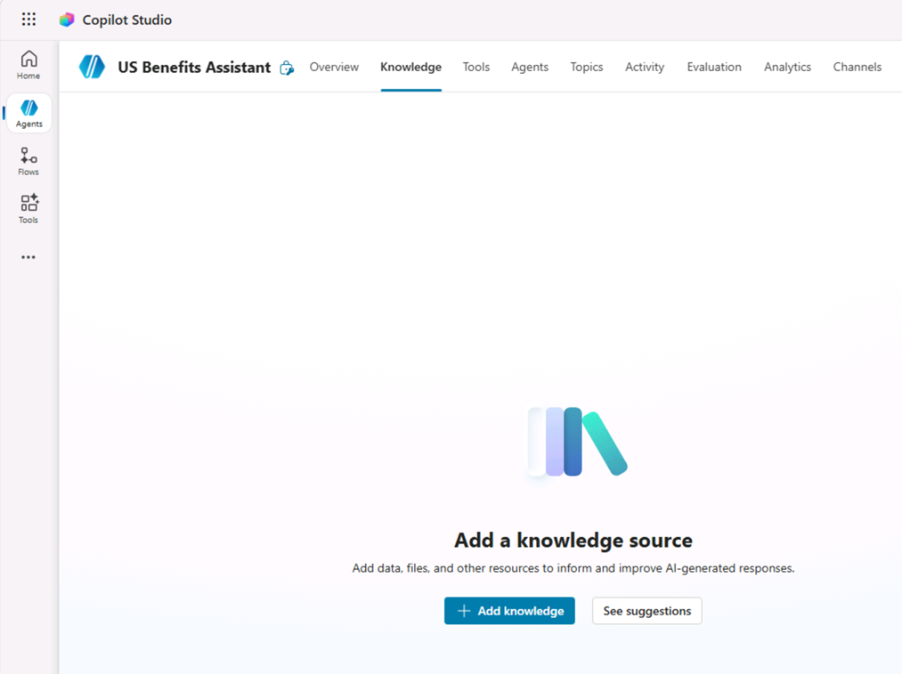

1. Select **+ Add knowledge**.

1. Select **Public websites**.

1. In the **Public website link** text box, enter **`https://www.usa.gov/benefits`**. This official government public website has details on benefits programs that could be useful for your agent.

1. Select **Add**.

1. For **Name**, replace the default name with `Government benefits`.

1. For **Description**, replace the default description with:

   ```text
   This knowledge source contains information on government programs that may help you pay for food, housing, health care, and other basic living expenses.
   ```

1. Select **Add to agent**.

   > [!NOTE]
   > Public website indexing may take several minutes. If responses are incomplete, wait a few minutes and test the agent again.

### Task 2.4 – Agent settings

1. In the upper-right of the page, select the **Settings** button.

1. Note that **Orchestration** is set to **Yes - Responses will be dynamic, using available tools and knowledge as appropriate**.

1. In the **Responses** section, enter the following:

   ```prompt
   - For process related answer respond with a single sentence.
   - For data-related answers respond with bullet points.
   ```

1. Scroll down you will find **Knowledge** section, set **Allow ungrounded responses** to **Off**.

1. In the **Knowledge** section, set **Use information from the Web** to **On**.

1. Select **Save**

1. In the left-hand side of the **Settings** page, select **Security**.

1. Select **Authentication**.

1. Select **No authentication** for this lab scenario to simplify testing in the Demo website channel.

1. Select **Save** and select **Save** again.

1. In the upper-right of the **Settings** page, select **X** to close settings.

### Task 2.5 – Test the agent

1. If the **Test** pane is not visible, select the **Test** icon in the upper-right of the page.

1. In the **Test** pane, select the ellipses (**...**) next to the variables **{x}** icon, and toggle **Show activity map when testing** to **On** and **Track between topics** to **Off**.

1. At the top of the **Test** pane, select the **Start new test session** icon **+**.

1. Enter the following prompt:

   ```prompt
   What health insurance information is available?
   ```

   The **Activity map** should be displayed, showing that knowledge sources were used to generate the response.

   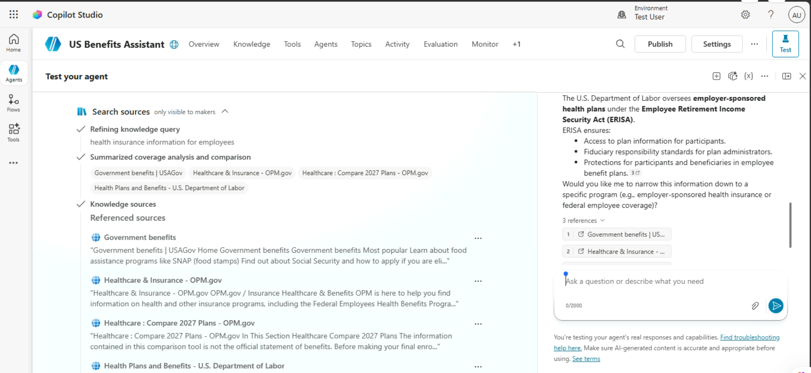

1. Close the **Test** pane.

### Task 2.6 – Publish the agent to the Demo website

1. In the action bar of the agent, select the **Publish** button and select **Publish** again.

1. Select the **Channels** tab.

   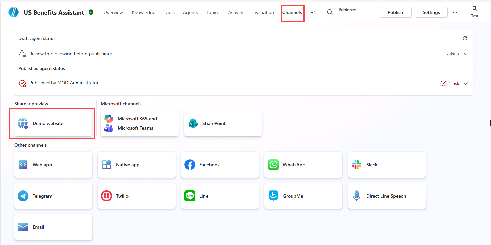

1. Select the **Demo website** channel. This channel is useful for quickly testing and previewing your agent experience.

1. In the **Demo Website** pane, enter the following settings:

   - **Welcome message**: `Ask me about government benefit programs`
   - **Conversation starters**:

      ```prompt
      "Hello"
      "What programs am I entitled to?"
      "What is social security?"
      ```

1. Select **Save**.

1. Select **Open demo website**.

1. Enter the following prompt:

   ```prompt
   What welfare and assistance can I claim for?
   ```

   The response should reference information from the configured knowledge source and may include citations or source references.
   
   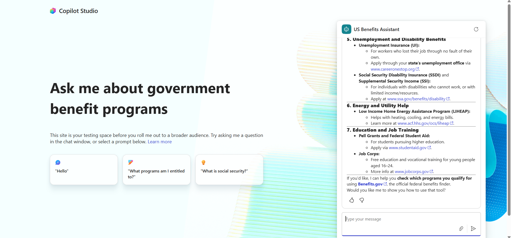

1. Try a few more questions and view the responses from your agent. It will have limited functionality, but should be able to provide relevant answers to questions about benefits.

## Summary

In this lab, you created an agent and defined its expected behavior using instructions. You also added a public website as a knowledge source and tested your agent with questions that the knowledge source could help answer. Later labs will show how to use topics, knowledge, and tools to further control agent behavior.
