---
lab:
  title: Manage topics in Copilot Studio agents
  module: Design agent conversations using topics
  description: In this lab, you will use Copilot to create an agent, create a topic from a description, add nodes, use entities, and manage variables.
  duration: 45 minutes
  level: 200
  islab: true
  primarytopics:
    - Microsoft Copilot Studio
---

# Manage topics in Copilot Studio agents

## Scenario

In this exercise, you will:

- Create an agent
- Manage existing topics
- Create and edit topics using Copilot
- Configure variable scope
- Create a topic manually
- Create and edit nodes
- Test the agent

This exercise will take approximately **45** minutes to complete.

## What you will learn

- How topics complement generative AI responses
- When topics are used to enforce structured conversations
- How to create and refine topics using natural language
- How to use variables

## High-level lab steps

- Create an agent using Copilot
- Review and disable unnecessary topics
- Create a topic using Copilot
- Edit topic content using natural language
- Test topic behavior

## Prerequisites

- Have a Microsoft Entra ID account
- Have a Copilot Studio license or have signed up for a free trial
- Have access to a Power Platform environment and a solution where you can create agents and related assets.
- You can use:
  - the environment and **Lab Exercises** solution created in the **ILT Setup** lab, or
  - your own existing environment and solution.
- If you do not already have an environment and solution prepared, complete the steps in the **ILT Setup** lab before continuing.
  
> [!IMPORTANT]
> You may notice a new Copilot Studio experience that is currently in preview. These labs use the current Copilot Studio interface, so some steps and screenshots may not match the preview experience. To follow the lab instructions successfully, use the current Copilot Studio UI throughout these exercises.

## Key concept: Agent components and behavior

When generative orchestration is enabled, the agent can use instructions, knowledge, topics, and tools to generate responses dynamically.

Topics are especially useful when you need to:

- Collect required information step by step
- Control the order of questions
- Store responses in variables
- Ensure predictable outcomes

## Exercise 1 - Create an agent

In this exercise, you will create a new agent to assist with reviewing insurance claims, including damage assessment details and repair estimates.

### **Task 1.1 – Create an agent to review insurance claims**

1. In the **Copilot Studio** home page `https://copilotstudio.microsoft.com/`, verify that you are working in the environment you created earlier and that you are using the **Classic Experience** UI.
2. Select **Agents** in the left-hand navigation.
3. Select **+ Create blank agent**.
4. Enter **Insurance Claims Review Assistant** as the agent name, then click the **Optional** section.
5. Leave **English (United States)** set as the primary language for the agent.
6. In the **Solution** drop-down, select **Lab Exercises**.
7. Enter `insuranceagent` for the *Schema name*.
8. Select **Create**.
9. Wait until the agent finishes setting up and the message `This feature isn't available until your agent has finished setting up.` **disappears**.
10. In the **Details** section, select **Edit**.
11. Set the following values:

| **Setting** | **Value**                                                                                          |
| ----------- | -------------------------------------------------------------------------------------------------- |
| Description | Assists with reviewing insurance claims, including damage assessment details and repair estimates. |

12. Click **Save**.
13. In the **Instructions** section, select **Edit** and enter:

```
You are an Insurance Claims Assistant that helps review insurance claims.

Your responsibilities include:
- Reviewing insurance claims.
- Analyzing damage assessment details.
- Reviewing repair estimates.
- Providing guidance based on the available claim information.
```

14. Click **Save**.

## Exercise 2 - Manage topics

In this exercise, you will disable the Escalate system topic as the agent will not have human representatives to hand-off to. Disabling unused system topics helps reduce ambiguity when generative orchestration determines how to respond.

### Task 2.1 – Disable topics

1. Select the **Topics** tab.

1. Select the **System** filter.

1. Locate the **Escalate** topic.

1. Toggle **Enabled** to **Off** for the **Escalate** topic.

   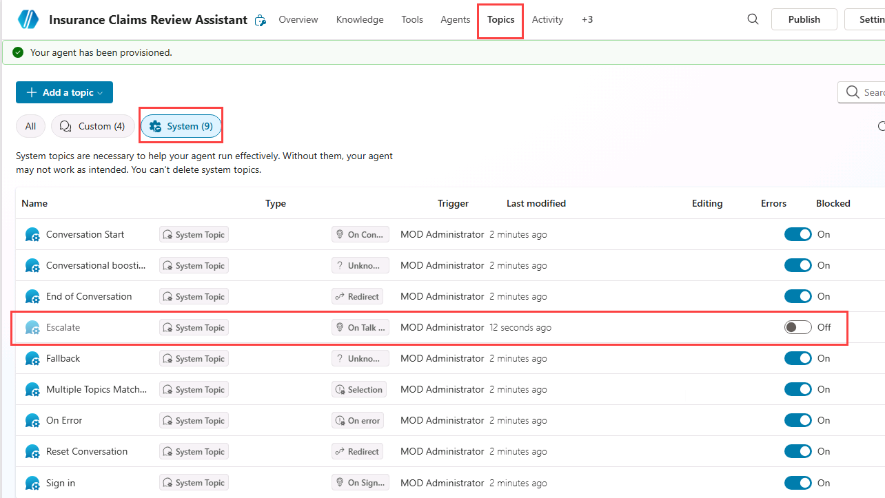

Disabling unused topics helps reduce ambiguity when multiple topics or generative responses could handle the same request.

## Exercise 3 - Create a topic with natural language

In this exercise, you will use Copilot to create a topic from a description. This allows generative AI to draft the initial structure, which you can then refine.

### Task 3.1 – Add a topic from description

1. Select **+ Add a topic** and select **Add from description with Copilot**. A new dialog appears.

   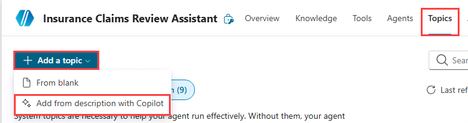

   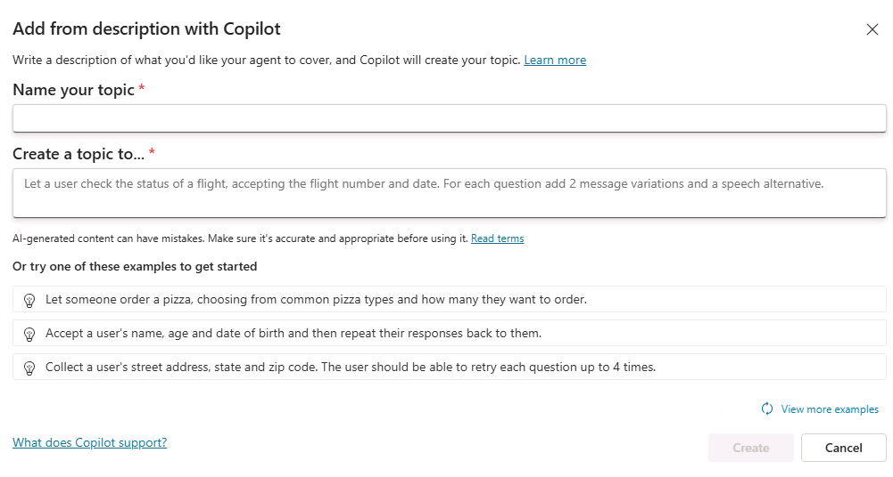

1. In the **Name your topic** text box, enter **`Customer Details`**.

1. In the **Create a topic to...** text box, enter **`Ask the customer for their name and email address`**.

1. Select **Create**.

1. Select **Save**.

### Task 3.2 – Edit nodes using natural language

1. If the **Test your agent** panel is open, close the panel.

1. If the **Edit with Copilot** panel is not shown on the right side of the **Customer Details** pane, select the **Copilot** icon in the upper part of the authoring canvas.

   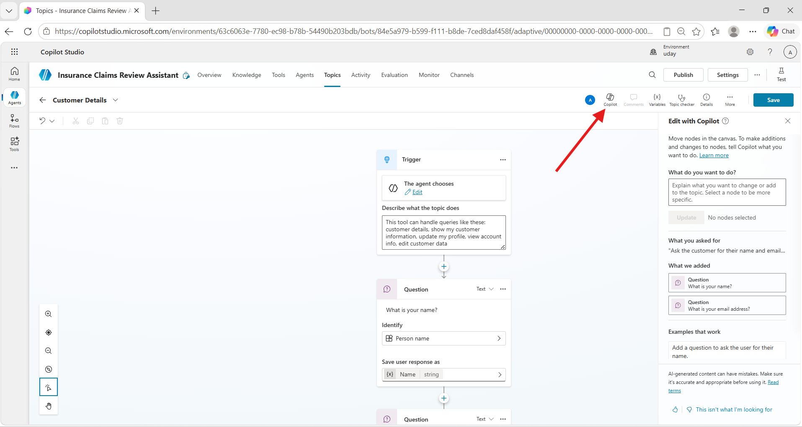

1. Select the second **Question** node **What is your email address?**

   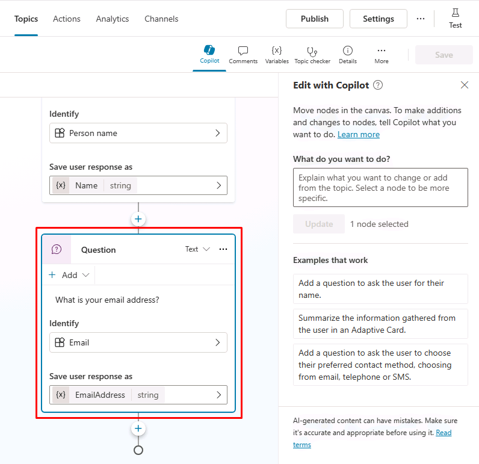

1. In the **Edit with Copilot** panel, in the **What do you want to do?** field, enter the following text:

   `Replace "What is your email address?" to say thank you to the Name variable from the previous node and then proceed to ask the email address question.`

1. Select **Update**.

   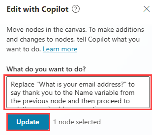

   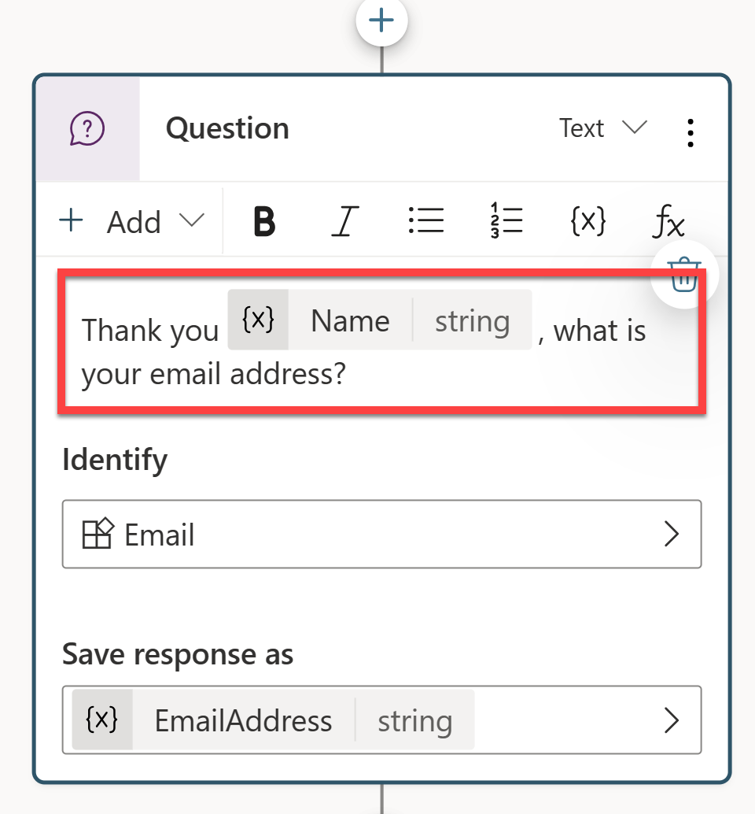

   > [!NOTE]
   > The updated message should reference the **Name** variable collected in the previous question node and should look similar to the screenshot. If **Edit with Copilot** did not update the question node correctly, select **Undo**, and retry with a different prompt.

1. Select **Save**.

### Task 3.3 – Add an adaptive card node using natural language

In addition to modifying existing nodes, you can use Copilot to add new ones.

1. Select an empty area on the authoring canvas so no node is selected.

1. In the **Edit with Copilot** panel, in the **What do you want to do?** field, enter the following text:

   `Summarize the information collected in an adaptive card`

1. Select **Update**.

   A message node with an Adaptive Card is added to the end of the topic.

   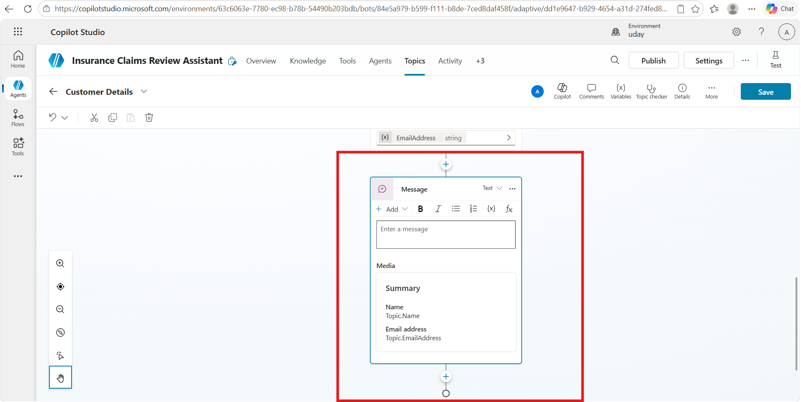

1. Select the **Selection Tool** on the left, then select the **Media** box in the Adaptive Card. The Adaptive Card properties should appear on the right side of the page.

   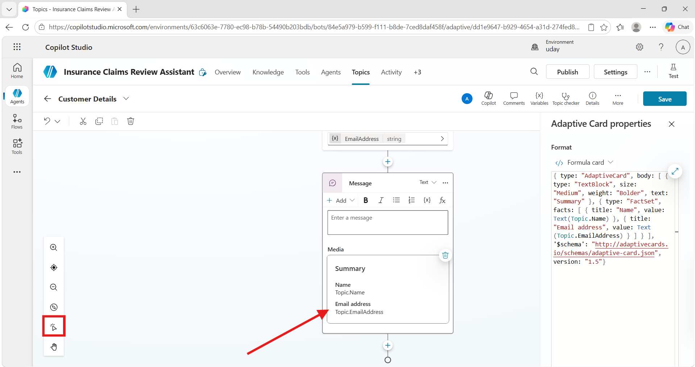

   Copilot may generate a different Adaptive Card formula. To ensure consistency, replace the generated formula with the following formula:

   ```powerfx
   {
   type: "AdaptiveCard", 
       body: 
       [
           {
               type: "TextBlock",
               size: "Medium",
               weight: "Bolder",
               text: "Summary"
           },
           {
               type: "FactSet",
               facts: 
               [
                   {
                       title: "Full Name",
                       value: Text(Topic.Name)
                   },
                   {
                       title: "Email Address",
                       value: Text(Topic.EmailAddress)
                   }
               ]
           },
           {
               type: "TextBlock",
               text: "Thank you for providing the information."
           }
       ]
   }
   ```

### Task 3.4 – Add a question node using natural language

1. Make sure that no node is selected by selecting the empty space in the authoring canvas.

1. Select the **Copilot** icon to reopen the **Edit with Copilot** pane.

1. In the **What do you want to do?** field, enter the following text:

   `Add a new multiple choice question to prompt the user if the details are correct with two options Yes or No`

1. Select **Update**.

1. A new question node is added to the end of the topic with options for the user to select.

   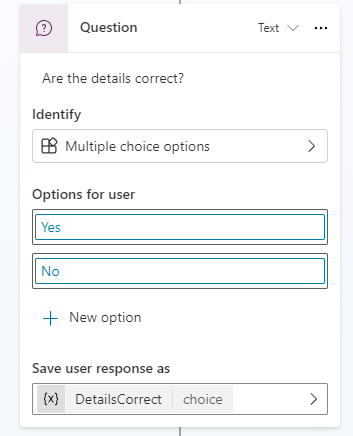

1. Select **Save**.

## Exercise 4 - Variable scope

Enable variables to be accessed by other topics.

### Task 4.1 - Configure the scope of the variables

1. Select the **Topics** tab.

1. Select the **Customer Details** topic. If multiple **Customer Details** topics are listed, select the one with the most recent **Last modified** time.

1. Select **Variables** in the top bar to open the **Variables** pane.

1. Select and expand **Topic** variables.

1. Select the right-hand check boxes for the three topic variables. This makes the variables available across other topics in the agent.

   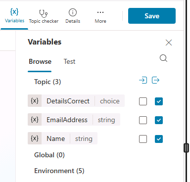

1. Select **Save**.

## Exercise 5 - Create a topic from blank

In this exercise, you will create the **Estimate Repair** topic, add nodes, and call the Customer Details topic.

### Task 5.1 - Create a topic from blank

1. Select the **Topics** tab.

1. Select **+ Add a topic** and select **From blank**.

1. Select the **Details** icon to open the **Topic details** pane (you may need to select **More** \> **Details**).

1. In the **Name** field, enter the following text:

   `Estimate Repair`

1. In the **Model description** field, enter the following text:

   `Use this topic when a repair estimate for an insurance claim must be booked with the customer`

   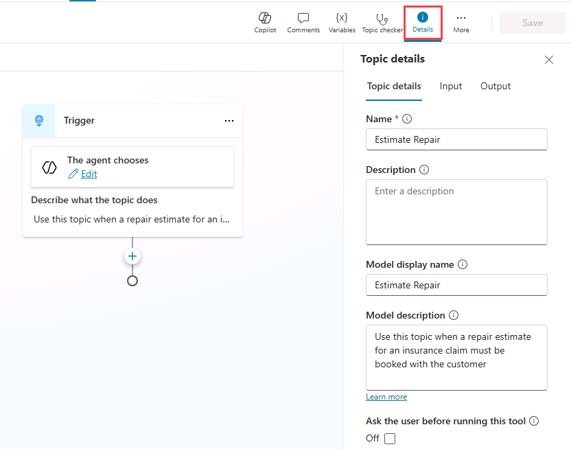

1. Select **Save**.

### Task 5.2 - Verify Trigger

1. At the top of the topic, verify that the **Trigger** node is present.

> [!NOTE]
>
> With generative orchestration enabled, the agent uses the topic description to decide when to use the topic.


### Task 5.3 - Add a message node

1. Select the **+** icon under the Trigger node and select **Send a message**.

   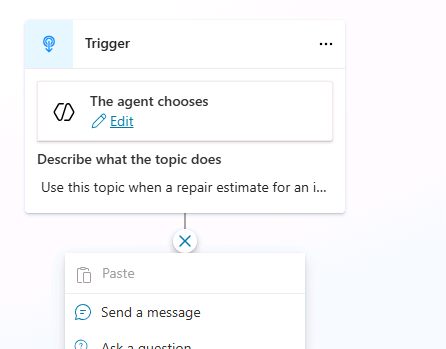

1. In the **Enter a message** field, enter the following text:

   `Hi, I can help you with booking a repair estimate.`

1. Select **Save**.

### Task 5.4 - Route to the Customer Details topic

1. Select the **+** icon under the **Message** node

1. Select **Topic management** > **Go to another topic** > **Customer Details**.

   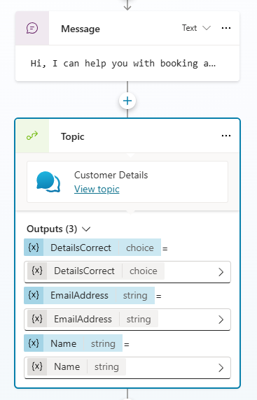

   > [!NOTE]
   > If two **Customer Details** topics are listed, select the **second one** and verify that the resulting node matches the following screenshot. If it does not match, delete the node and repeat the step using the **first Customer Details** topic.

1. Select **Save**.

### Task 5.5 - Add condition node

1. Select the **+** icon under the **Topic** node and select **Add a condition**.

1. In the **Condition** node, select the **Select a variable >** then  choose **DetailsCorrect** variable.

1. Select **is equal to**.

1. Select **Yes** for **Enter or select a value**

   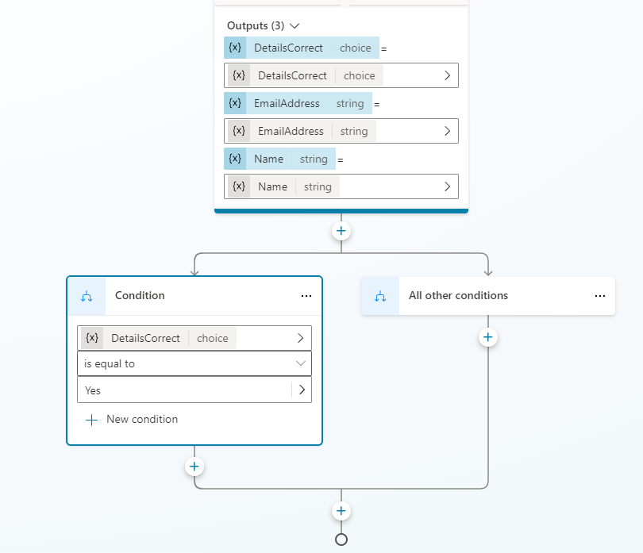

1. Select **Save**.

### Task 5.6 - Add question nodes

1. Select the **+** icon under the left **Condition** node and select **Ask a question**.

1. In the **Enter a message** field, enter the following text:

   `What date and time would you like to book the repair estimate?`

1. Select **Date and time** for **Identify**. If you have difficulty finding it, use the **search box** in the **brackets** to search for it.

   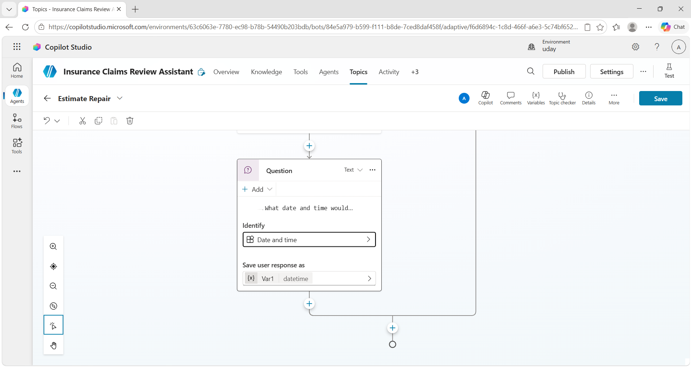

1. Select the variable in **Save user response as** and enter **`VisitDateTime`** for **Variable name**

   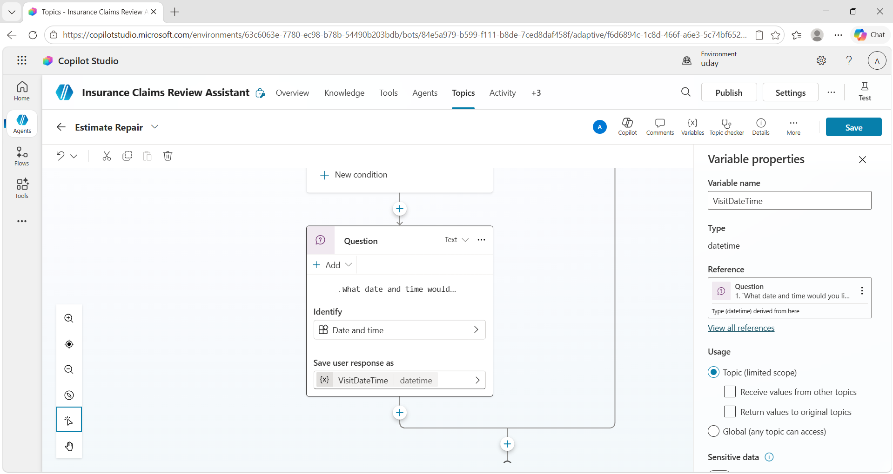

1. Select the **+** icon under the left **Question** node and select **Send a message**.

1. In the **Enter a message** field, enter the following text:

   `Great! Let me get that scheduled for you.`

1. After that message node, add a node to end the topics by selecting **Topic management** \> **End all topics**.

   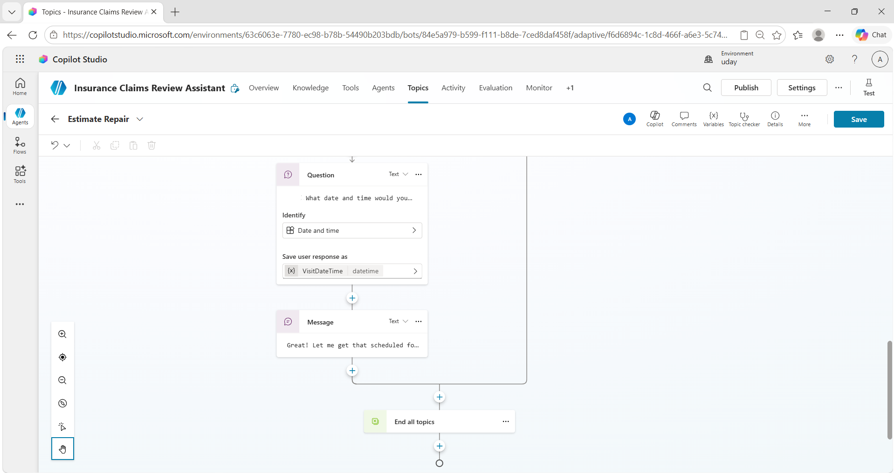

1. Select **Save**.

### Task 5.7 - Update agent instructions

1. Select the **Overview** tab.

1. In the **Instructions** section, select **Edit**.

1. Under *# Skills* in the agent instructions, enter `- Use the`, then type `/` and select the **Estimate Repair** topic, then enter `when a repair estimate is required.`

   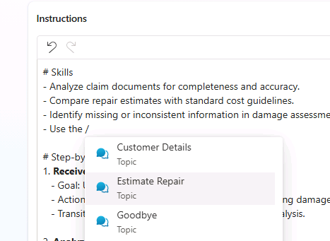

1. Select **Save**.

> [!TIP]
> **Skills Section missing? Configure the Skills Section**
>
> 1. Under **Instructions**, check whether the `# Skills` section is already present.
> 2. If the `# Skills` section is missing, add it before proceeding.
> 3. Under `# Skills`, add the following entries:
>
>    ```text
>    # Skills
>    - Analyze claim documents for completeness and accuracy.
>    - Compare repair estimates with standard cost guidelines.
>    - Identify missing or inconsistent information in damage assessments.
>    ```
>
> 4. On a new line under the existing skills, enter `- Use the`.
> 5. Type `/` and select the **Estimate Repair** topic from the suggestions.
> 6. After selecting the topic, enter `when a repair estimate is required.`
>
> **Troubleshooting:** If the **Estimate Repair** topic does not appear in the suggestions, verify that it has been created and is available in the agent. If it is missing, create the topic first and repeat steps 4–6.
>
> 7. You can also add the following `# Step-by-step` section to the instructions:
>
>    ```text
>    # Step-by-step
>    1. Receive the customer's repair request.
>       - Goal: Understand the customer's repair requirements.
>       - Action: Collect the necessary claim and damage details.
>       - Transition: Proceed to estimate review.
>
>    2. Review the repair estimate.
>       - Goal: Verify the estimate details.
>       - Action: Compare the proposed repair costs with standard cost guidelines.
>       - Transition: Identify any discrepancies or missing information.
>
>    3. Validate the claim information.
>       - Goal: Ensure the submitted information is complete and accurate.
>       - Action: Check the claim documents and damage assessment details.
>       - Transition: Proceed with the repair estimate decision.
>    ```
>
> 8. Select **Save**.

## Exercise 6 - Test the agent

In this exercise, you will test topic routing and confirm the conversation follows the expected step-by-step flow.

### Task 6.1 - Test the Estimate Repair topic

1. Select the **Test** icon in the upper-right of the page to open the **Test** pane.

1. In the **Test** pane, select the ellipses (**...**) next to the variables **{x}** icon, and toggle **Show activity map when testing** to **On** and **Track between topics** to **Off**.

   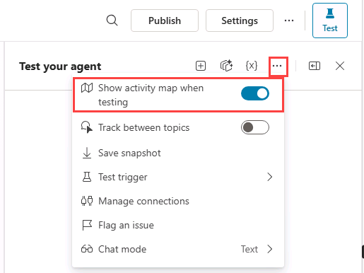

1. At the top of the **Test pane**, select the **Start new test session** icon **+**.

1. When the **Conversation Start** message appears, your agent will start a conversation. In response, enter the following text to trigger the topic:

   `I need to book a repair estimate`

   > [!TIP]
   > If you see the error **"Two or more actions and/or topics have the same identifier 'Customer-Details'"**, the **Customer Details** topic from Lab 1 is still enabled. Turn it **off** before continuing. If you see two **Customer Details** topics, use their **Last modified** time to distinguish them: the more recently modified topic is associated with Lab 2, while the older one is associated with Lab 1.

1. The conversation should begin by asking for the customer's name.

   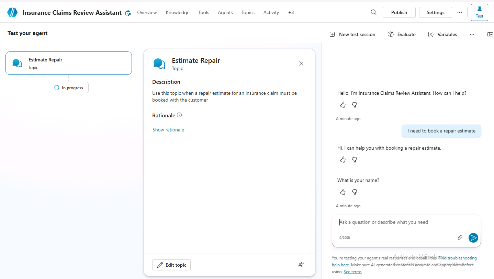

1. Provide a name.

1. Provide an email address.

1. After you supply the information, an Adaptive Card displays the information that you entered and asks if the details are correct. Select **Yes**.

   Notice that the conversation flow returns to the **Estimate Repair** topic.

1. Enter `Tomorrow 10:00 AM` in response to the **What date and time would you like to book the repair estimate?** prompt.

   The agent responds with:
   
   `Great! Let me get that scheduled for you.`

## Summary

In this lab, you created the Customer Details and Estimate Repair topics and used nodes to enforce a structured, step-by-step interaction while generative AI remained enabled. You also configured variable scope so information collected in Customer Details can be used across topics.
